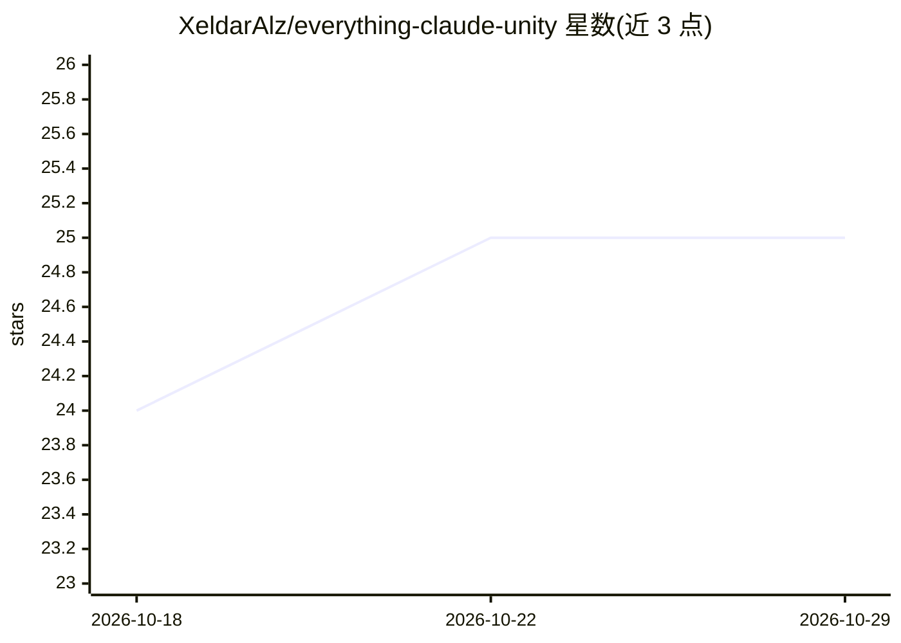

# XeldarAlz/everything-claude-unity

⭐ 25 · Shell · MIT · 推送 2026-04-24 · [GitHub](https://github.com/XeldarAlz/everything-claude-unity) · [官网](https://github.com/XeldarAlz/everything-claude-unity#readme) · 个人维护 · 中文 README

**给独立 Unity 开发者的 Claude Code 工具集：20 个 agent 加安全钩子**

面向单人独立游戏开发者的 Claude Code 插件包：通过 install.sh 拷入 Unity 项目，为 Claude Code 提供 20 个子 agent（按 haiku/sonnet/opus 三档自动路由）、22 个斜杠命令（如 /unity-workflow 四阶段流水线、/unity-prototype 一句话出原型、/unity-ralph 持续验证修复循环）、41 个 Unity 知识技能模块、22 个安全钩子（阻止场景/meta 文件损坏、序列化数据丢失）及 MVS 架构模板。可配合 unity-mcp 实现对话中构建场景、性能分析与 iOS/Android 打包。要求已安装 Claude Code 与 Unity 2021.3 LTS 以上。

## 筛选速览

| 维度 | 判定 | 备注 |
|---|---|---|
| AI 角色 | `ai-ecosystem` | LLM/agent 周边工具 |
| 许可风险 | `permissive` | MIT |
| 部署形态 | `None` |  |
| 模型依赖 | locked-api |  |
| 硬件要求 | — | 无带数字的原话,不猜 |
| 安装摩擦 | `low` | 无编译、无系统依赖或容器化 |
| 成熟度 | — | 结构信号不足 |

## 能力要点

- 20 个专业子 agent，按任务复杂度在 haiku/sonnet/opus 间自动路由
- 22 个安全钩子防止场景/meta 损坏与序列化数据丢失，分 minimal/standard/strict 三档
- 22 个斜杠命令覆盖原型、审查、测试、构建、迁移等开发流程
- 支持并行 agent 编排（/unity-team）与持续验证修复循环（/unity-ralph，最多 30 轮验证）

## 适用场景

- 在 Unity 项目中用自然语言让 Claude Code 实现功能、修 bug、出可玩原型
- 防止 AI 直接编辑 .unity/.prefab/.meta 文件导致引用损坏
- 通过对话触发性能分析、测试运行与 iOS/Android 打包
- 对 Unity 项目做代码审查、安全审计与健康检查

## 场景标签

`编码 Agent` `代码审查` · 领域:编码与开发

## 证据(README 行号)

> L13: **The ultimate Claude Code toolkit for Unity game development.**
> L21: - **Drop-in, zero-config** — one `install.sh` and Claude Code knows Unity inside out

## 星数曲线

2026-10-18 24 → 2026-10-29 25（+1）

---
*卡片 v1 · prompt 1.4 · 生成 2026-10-27 · 置信度 high · 依据 README sha `1c2f22a7add8` · [字段定义](../../DATASET.md)*
