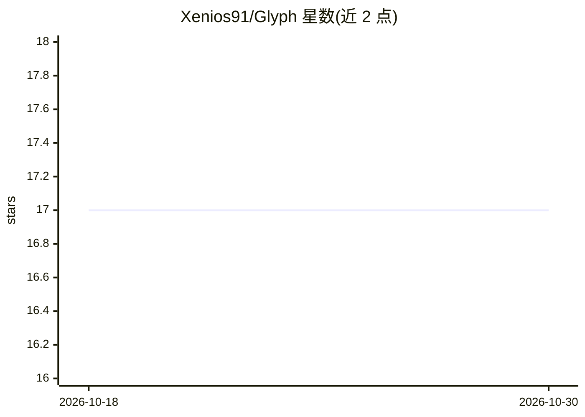

# Xenios91/Glyph

⭐ 17 · Python · NOASSERTION · 推送 2026-10-15 · [GitHub](https://github.com/Xenios91/Glyph) · 个人维护

**跨架构二进制函数指纹识别与危险函数扫描平台**

面向安全研究者的 ELF（32/64 位）二进制分析 Web 平台：通过 Ghidra/PyGhidra 反编译，用 scikit-learn 分类器与 NLP 技术做跨体系结构的函数指纹识别；另提供基于 CWE 目录的危险函数扫描（可选经 OpenAI 兼容端点做 LLM 辅助分析并给出 VULNERABLE/NOT_VULNERABLE 判定）、二进制相似度、代码复用检测、调用图可视化与二进制库管理，经 Web UI 与带 JWT/API key 认证的 REST API 交付。需 Python 3.11+、Ghidra 12.0+，以源码方式克隆安装后用 uvicorn 运行。曾入选 Black Hat Arsenal 2022/2023 与 Defcon Demo Labs。

## 筛选速览

| 维度 | 判定 | 备注 |
|---|---|---|
| AI 角色 | `ai-enhanced` | 去掉 AI 部分产品仍成立 |
| 许可风险 | `none` | NOASSERTION |
| 部署形态 | `library` | 以包/库形式分发 |
| 模型依赖 | local-ok | 支持本地模型 |
| 硬件要求 | — | 无带数字的原话,不猜 |
| 安装摩擦 | `low` | 无编译、无系统依赖或容器化 |
| 成熟度 | — | 结构信号不足 |

## 能力要点

- 跨体系结构函数指纹识别（scikit-learn 训练与预测）
- 危险函数扫描基于 CWE 目录，可选 LLM 辅助分析输出结构化判定
- 二进制相似度计算与代码复用检测
- Web UI 与 JWT/API key 认证的 REST API，后台任务执行长耗时分析

## 适用场景

- 识别 IoT 固件中跨架构复用的恶意或脆弱函数
- 扫描二进制中的危险 API 使用并获取 LLM 风险评估
- 通过相似度计算发现恶意软件家族或重打包样本

## 场景标签

`网络安全` · 领域:学习与行业

## 证据(README 行号)

> L5: Glyph decompiles 32- and 64-bit ELF binaries with Ghidra and applies machine learning and natural language processin
> L8: - **Dangerous function scanning** — detect risky API usage against a curated CWE catalog with severity ratings, plus
> L21: - LLM-assisted analysis of dangerous function findings via any OpenAI-compatible chat completions endpoint (OpenAI,

## 星数曲线

2026-10-18 17 → 2026-10-30 17（+0）

---
*卡片 v1 · prompt 1.4 · 生成 2026-10-29 · 置信度 high · 依据 README sha `51a6511d1826` · [字段定义](../../DATASET.md)*
