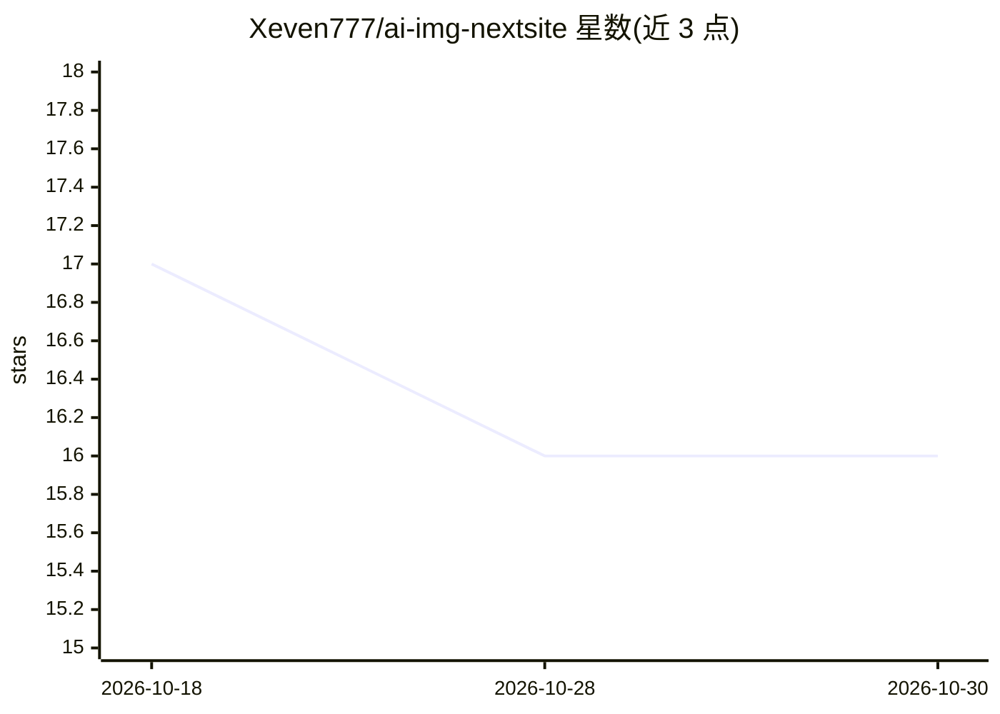

# Xeven777/ai-img-nextsite

⭐ 16 · TypeScript · 推送 2025-12-24 · [GitHub](https://github.com/Xeven777/ai-img-nextsite) · [官网](https://img-gen7.netlify.app/) · 个人维护

**Next.js AI 图像生成前端应用，支持 7 种文生图模型**

基于 Next.js 15 / TypeScript / Tailwind / shadcn/ui 的图像生成 Web 应用，提供 Flux Schnell、Flux Dev、Lucid Origin、Phoenix、SDXL 变体与 Dreamshaper 共 7 种模型选择，暴露 /img GET 接口，支持 prompt、negative prompt、宽高（256-2048px）、steps、seed 等参数，并在客户端按模型实施请求频率限制（localStorage 记录）。注意：本产品是前端，需自行配置后端图像生成 API 端点（环境变量 NEXT_PUBLIC_URL）才能工作。安装需 Node.js 18+ 与 Bun，支持 Netlify/Vercel 部署。

## 筛选速览

| 维度 | 判定 | 备注 |
|---|---|---|
| AI 角色 | `ai-native` | 本体是模型或模型工具 |
| 许可风险 | `none` | — |
| 部署形态 | `library` | 以包/库形式分发 |
| 模型依赖 | — | README 未给出锁定关系 |
| 硬件要求 | — | 无带数字的原话,不猜 |
| 安装摩擦 | `low` | 无编译、无系统依赖或容器化 |
| 成熟度 | — | 结构信号不足 |

## 能力要点

- 7 种图像生成模型可选，含模型特定参数自动默认值
- GET /img 接口，支持 prompt/negative prompt/尺寸/steps/seed
- 客户端按模型分级限流（4-8 次/分钟）
- 提供 Netlify 与 Vercel 部署路径

## 适用场景

- 自建文生图 Web 界面并调用自己的后端生成 API
- 通过 URL 参数以 GET 请求方式生成图像（如 cURL 调用）
- 作为文生图 API 的前端演示与部署模板

## 场景标签

`图像生成` · 领域:内容生成

## 证据(README 行号)

> L3: A modern Next.js application for generating stunning AI images using multiple state-of-the-art image generation mode
> L7: - **7 AI Models**: Choose from Flux Schnell, Flux Dev, Lucid Origin, Phoenix, Stable Diffusion variants, and Dreamsh
> L219: **Note**: This is a frontend application that requires a backend API for image generation. Make sure to configure 

## 星数曲线

2026-10-18 17 → 2026-10-30 16（-1）

---
*卡片 v1 · prompt 1.4 · 生成 2026-10-30 · 置信度 mid · 依据 README sha `70cb9b0dc184` · [字段定义](../../DATASET.md)*
