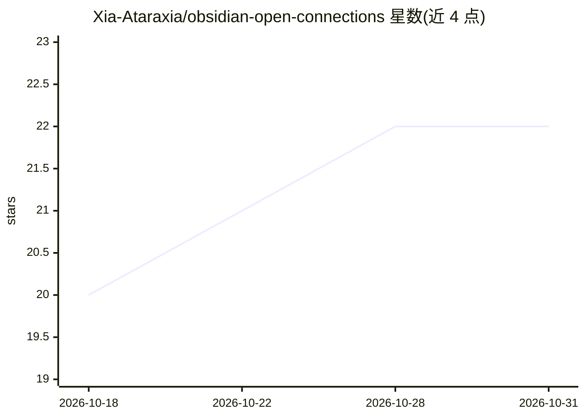

# Xia-Ataraxia/obsidian-open-connections

⭐ 22 · TypeScript · GPL-3.0 · 推送 2026-10-26 · [GitHub](https://github.com/Xia-Ataraxia/obsidian-open-connections) · 个人维护

**Obsidian 插件：语义关联笔记展示与语义搜索，附带 MCP 服务器**

面向 Obsidian 用户的笔记关联插件：基于嵌入向量在 Connections 视图列出与当前笔记语义相关的笔记，Lookup 视图支持按含义而非关键词搜索整个 vault。默认使用本地嵌入（Transformers.js，WebGPU 加速、WASM 回退），可选 OpenAI、Gemini、Ollama、LM Studio 等提供商；嵌入本地缓存。内置 MCP 服务器可将 vault 的关联暴露给 MCP 客户端，仅监听 127.0.0.1。仅支持桌面端 Obsidian 1.13.0+，GPL-3.0，为 Smart Connections 的分支。

## 筛选速览

| 维度 | 判定 | 备注 |
|---|---|---|
| AI 角色 | `ai-enhanced` | 去掉 AI 部分产品仍成立 |
| 许可风险 | `viral` | GPL-3.0 |
| 部署形态 | `None` |  |
| 模型依赖 | local-ok | 支持本地模型 |
| 硬件要求 | — | 无带数字的原话,不猜 |
| 安装摩擦 | `low` | 无编译、无系统依赖或容器化 |
| 成熟度 | — | 结构信号不足 |

## 能力要点

- Connections 视图实时列出语义相关笔记
- Lookup 视图支持按含义而非关键词搜索
- 默认本地嵌入（Transformers.js，WebGPU/WASM），无需 API key
- MCP 服务器向 MCP 客户端暴露 vault 关联

## 适用场景

- 在笔记库中发现与当前笔记语义相关的其他笔记
- 用自然语言查询代替关键词搜索笔记
- 让 MCP 客户端访问笔记间的语义关联

## 场景标签

`语义搜索` · 领域:知识与检索

## 证据(README 行号)

> L9: - Connections view lists notes related in meaning to the note you have open, and updates as you navigate.
> L11: - Local embeddings by default (Transformers.js with WebGPU, WASM fallback), or OpenAI, Gemini, Ollama, LM Studio, U

## 星数曲线

2026-10-18 20 → 2026-10-31 22（+2）

---
*卡片 v1 · prompt 1.4 · 生成 2026-10-28 · 置信度 high · 依据 README sha `6e3574f687c9` · [字段定义](../../DATASET.md)*
