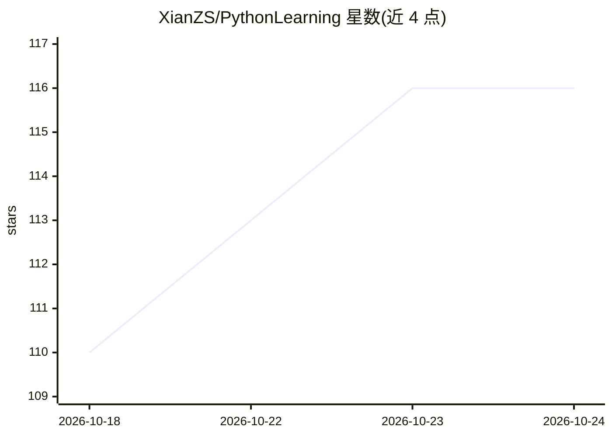

# XianZS/PythonLearning

⭐ 116 · Python · MIT · 推送 2026-08-27 · [GitHub](https://github.com/XianZS/PythonLearning) · [官网](https://xianzs.github.io/) · 个人维护 · 中文 README

**面向初学者的 Python 分阶段学习文档与代码仓库**

包含基础、进阶、标准库、实战（RAG 项目）与面试八股文五个模块的 Python 学习仓库，每模块配套学习文档（word 目录）、代码文件与 B 站免费教学视频。内容覆盖变量、流程控制、OOP、并发编程、标准库模块用法等，进阶部分含爬虫与数据库练习，实战部分为 RAG 项目（正在更新）。通过 git clone 获取并自行配置环境使用。

## 筛选速览

| 维度 | 判定 | 备注 |
|---|---|---|
| AI 角色 | `ai-knowledge` | 知识聚合/清单类 |
| 许可风险 | `permissive` | MIT |
| 部署形态 | `library` | 以包/库形式分发 |
| 模型依赖 | — | README 未给出锁定关系 |
| 硬件要求 | — | 无带数字的原话,不猜 |
| 安装摩擦 | `low` | 无编译、无系统依赖或容器化 |
| 成熟度 | `idea` | |

## 能力要点

- 基础/进阶/标准库/实战/八股文五模块学习路线
- 每模块配套文档、代码与免费 B 站教学视频
- 进阶部分含爬虫、数据库、并发编程综合项目

## 适用场景

- 零基础系统学习 Python 并跟做配套项目
- 查找 Python 标准库模块的使用场景说明
- 准备 Python 面试八股文复习

## 场景标签

`教程课程` · 领域:学习与行业

## 证据(README 行号)

> L7: > 这是一个包含了“基础”、“进阶”、“标准库”、“实战”和“八股文”的`python`学习仓库。
> L17: - 1. （必选-已完成更新） `Python基础学习`：`./python_basic_learning/`

## 星数曲线

2026-10-18 110 → 2026-10-24 116（+6）

---
*卡片 v1 · prompt 1.4 · 生成 2026-10-23 · 置信度 mid · 依据 README sha `d098903d71d6` · [字段定义](../../DATASET.md)*
