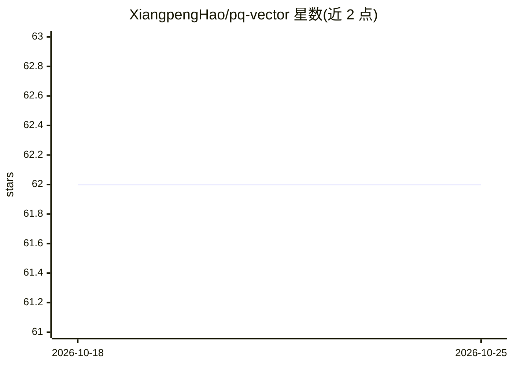

# XiangpengHao/pq-vector

⭐ 62 · Rust · 推送 2026-02-11 · [GitHub](https://github.com/XiangpengHao/pq-vector) · 个人维护

**Rust 向量检索库：索引存于 Parquet 文件内并用 DataFusion SQL 查询**

以 Rust 库形式提供的嵌入式向量检索方案：通过 IndexBuilder 在 Parquet 文件内部构建向量索引，不产生独立索引文件；索引后的文件仍是标准 Parquet，可被 DuckDB、Pandas 等常规读取。检索侧提供 Rust API（TopkBuilder）与 DataFusion 集成，可在 SQL 中执行向量 TopK 查询，并支持零拷贝原地索引；参数 k 控制返回结果数，nprobe 在速度与召回率之间权衡。面向需要在既有 Parquet 数据上做向量检索的开发者。

## 筛选速览

| 维度 | 判定 | 备注 |
|---|---|---|
| AI 角色 | `ai-ecosystem` | LLM/agent 周边工具 |
| 许可风险 | `none` | — |
| 部署形态 | `None` |  |
| 模型依赖 | — | README 未给出锁定关系 |
| 硬件要求 | — | 无带数字的原话,不猜 |
| 安装摩擦 | `low` | 无编译、无系统依赖或容器化 |
| 成熟度 | — | 结构信号不足 |

## 能力要点

- 索引直接存储在 Parquet 文件内部，无独立索引文件
- 索引后文件仍是标准 Parquet，DuckDB/Pandas 可正常读取
- DataFusion 集成：通过 SQL 执行向量 TopK 查询
- 零拷贝、原地 Parquet 索引构建

## 适用场景

- 在已有 Parquet 数据湖上直接做向量检索，无需另建向量库
- 通过 DataFusion SQL 在分析流水线中加入向量查询
- 希望索引与数据同文件存储、保持标准兼容性的场景

## 场景标签

`向量数据库` · 领域:知识与检索

## 证据(README 行号)

> L5: Vector Search with only Parquet and DataFusion
> L11: - **DataFusion integration**: Ergonomic vector search with just SQL.

## 星数曲线

2026-10-18 62 → 2026-10-25 62（+0）

---
*卡片 v1 · prompt 1.4 · 生成 2026-10-24 · 置信度 high · 依据 README sha `af6e8d3ae43d` · [字段定义](../../DATASET.md)*
