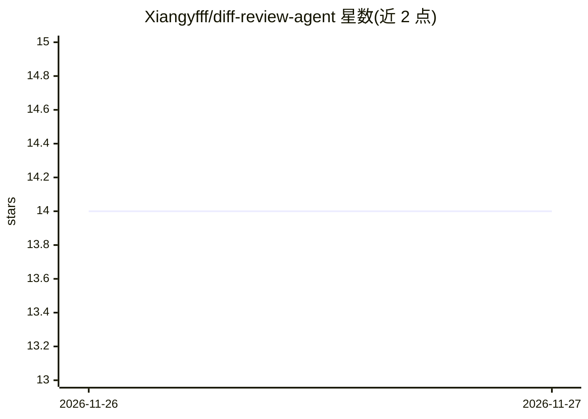

# Xiangyfff/diff-review-agent

⭐ 14 · Java · MIT · 推送 2026-11-24 · [GitHub](https://github.com/Xiangyfff/diff-review-agent) · 个人维护 · 中文 README

**给 Java 团队审查 git diff 的多阶段 LLM 代码审查 Agent**

面向 Java 仓库的代码审查智能体，读取两个提交间的 diff，经初审（规则与语法树分档）、深挖（带工具预算的取证循环）、复核（找反证）三段流水线产出审查评论。每条评论引用的编号、行号、符号由程序对照工具读过的原文校验，校验不过即丢弃。模型默认 DeepSeek，可选本地 Ollama，嵌入检索不依赖向量数据库。评测用 47 条变异体语料重放，测试全程离线。需要 JDK 21 与 Maven 从源码构建。

## 筛选速览

| 维度 | 判定 | 备注 |
|---|---|---|
| AI 角色 | `ai-native` | 本体是模型或模型工具 |
| 许可风险 | `permissive` | MIT |
| 部署形态 | `None` |  |
| 模型依赖 | local-ok | 支持本地模型 |
| 硬件要求 | — | 无带数字的原话,不猜 |
| 安装摩擦 | `medium` | 含编译或系统依赖之一 |
| 成熟度 | — | 结构信号不足 |

## 能力要点

- 三段式流水线：初审分档、有预算的取证深挖、专门找反证的复核
- 证据由程序校验：评论中的编号、行号、符号须与工具读取的原文对应
- 政策检索：docs/policies 文档按块编号可被引用并校验，嵌入由本地 Ollama 提供
- 191 个离线测试与变异体评测语料，支持三档深度消融

## 适用场景

- 审查 Java 仓库某两个提交间的改动并生成带证据的评论
- 把团队编码规范放进 docs/policies 参与审查
- 用本地 Ollama 模型离线跑审查循环
- 将审查结果回写到 GitHub Pull Request

## 场景标签

`代码审查` `RAG` · 领域:编码与开发

## 证据(README 行号)

> L11:  读 git diff，判断哪些改动值得深查，调只读工具取证，只输出能被证据支持的评论。
> L13: > 大多数代码审查智能体靠提示词请求模型“不要编造”。这里换了个方向：**证据由程序校验**。评论里引用的每个编号、每个行号、每个符号，都必须能在工具真正读过的原文里对上；对不上，这条评论就不会出现。
> L23: 三段式流水线：**初审**把 diff 切成函数级单元、先用规则和语法树找出形状变化；**深挖**带着问题读代码、查条款，逐个取证；**复核**换个视角找反证。三段之间只传结构化结论，不传聊天记录。

## 星数曲线

2026-11-26 14 → 2026-11-27 14（+0）

---
*卡片 v1 · prompt 1.4 · 生成 2026-11-26 · 置信度 high · 依据 README sha `8e6094b959b9` · [字段定义](../../DATASET.md)*
