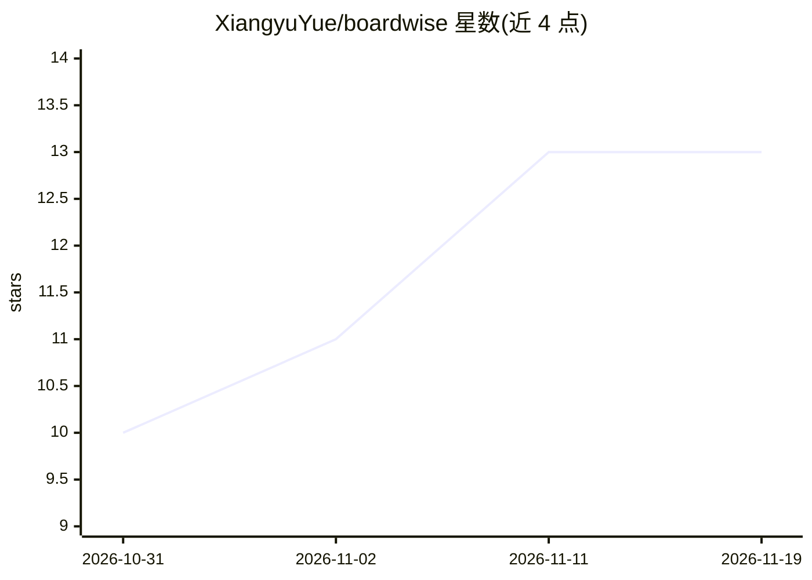

# XiangyuYue/boardwise

⭐ 13 · Python · MIT · 推送 2026-11-17 · [GitHub](https://github.com/XiangyuYue/boardwise) · 个人维护 · 中文 README

**硬件工程师的 EasyEDA Pro AI 审图工具：AI 读原理图做审查与编辑**

面向硬件工程师的 agent harness，让 Claude Code、DeepSeek、Kimi Code 等 AI 助手以结构化数据（元件/网络/引脚）读取 EasyEDA Pro 工程，而非截图。提供四类能力：审查（ERC/DRC、23 条设计规则、数据手册门控、画布标记）、经预览→授权→回读流程的本地编辑、Gerber/贴片/BOM 一键导出、以及离线绘图编译器。架构三层均在本地运行，不经过云端；编辑后自动回读复检。当前仅支持 Windows 与指定 EasyEDA Pro 版本，KiCad 平台处于计划阶段。

## 筛选速览

| 维度 | 判定 | 备注 |
|---|---|---|
| AI 角色 | `ai-native` | 本体是模型或模型工具 |
| 许可风险 | `permissive` | MIT |
| 部署形态 | `desktop` | 安装包/桌面程序 |
| 模型依赖 | — | README 未给出锁定关系 |
| 硬件要求 | — | 无带数字的原话,不猜 |
| 安装摩擦 | `low` | 无编译、无系统依赖或容器化 |
| 成熟度 | — | 结构信号不足 |

## 能力要点

- AI 助手读取元件/网络/引脚结构化数据而非截图进行审查
- 编辑采用预览→授权→回读→复检流程，未经批准不改动
- 全本地三层架构，数据不经过云端
- export-fab 一次写出 Gerber、贴片与 BOM

## 适用场景

- 让 AI 助手对原理图做设计规则审查并标注问题位置
- 在授权确认后由 AI 执行局部电路修改并复检
- 从 EasyEDA Pro 工程一次性导出生产文件
- 离线绘制分压/RC/LDO 等模块电路页

## 场景标签

 · 领域:EDA/硬件设计工具

## 证据(README 行号)

> L5: An agent harness for hardware engineers.
> L10: It lets an AI assistant (Claude Code, DeepSeek, Kimi Code — any of them)
> L113: Three layers, all on your own machine — nothing goes through a cloud:

## 星数曲线

2026-10-31 10 → 2026-11-19 13（+3）

---
*卡片 v1 · prompt 1.4 · 生成 2026-11-18 · 置信度 high · 依据 README sha `c31f9d6698bd` · [字段定义](../../DATASET.md)*
