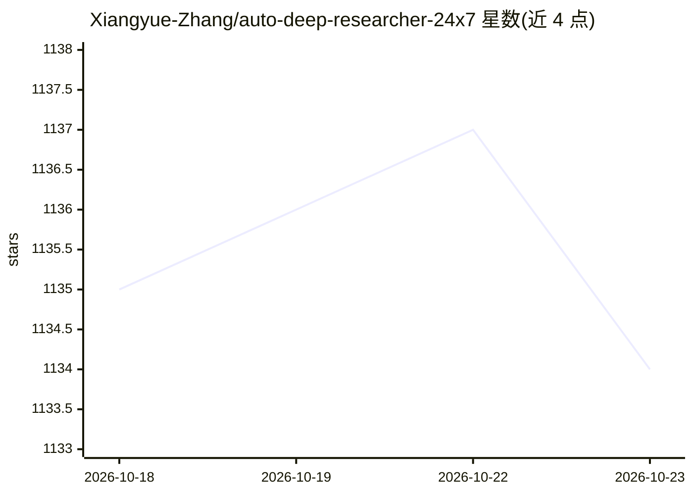

# Xiangyue-Zhang/auto-deep-researcher-24x7

⭐ 1,134 · Python · Apache-2.0 · 推送 2026-06-03 · [GitHub](https://github.com/Xiangyue-Zhang/auto-deep-researcher-24x7) · [官网](https://arxiv.org/abs/2604.05854) · 个人维护 · 中文 README

**24/7 自主运行深度学习实验的 AI agent**

面向已明确实验目标的研究者，用 LLM agent 接管改代码、启动训练、监控运行、解析日志、决定下一组超参的循环。采用思考-执行-监控-反思的循环结构，训练期监控零 LLM 调用（仅进程检查与日志读取）；实验台账与追加式研究日志（DEAD_ENDS/INSIGHTS）构成常数大小记忆。支持 local/SSH/Slurm 三种执行后端，提供 DeepSeek/Qwen/Kimi/GLM 等国内 API 预设及 Claude/Codex CLI 订阅模式。需 Python 3.10+、1 块以上 NVIDIA GPU 与 API key，通过 PROJECT_BRIEF.md 等文件由人控制方向，可选 Obsidian 进度同步。

## 筛选速览

| 维度 | 判定 | 备注 |
|---|---|---|
| AI 角色 | `ai-native` | 本体是模型或模型工具 |
| 许可风险 | `permissive` | Apache-2.0 |
| 部署形态 | `library` | 以包/库形式分发 |
| 模型依赖 | locked-api |  |
| 硬件要求 | — | 无带数字的原话,不猜 |
| 安装摩擦 | `low` | 无编译、无系统依赖或容器化 |
| 成熟度 | — | 结构信号不足 |

## 能力要点

- 思考-执行-监控-反思循环，24/7 无人值守跑实验
- 训练期监控零 LLM 调用，仅进程检查与日志读取
- 实验台账 + 追加式研究日志构成持久记忆与停滞信号
- local/SSH/Slurm 三种执行后端，支持 DeepSeek/Qwen/Kimi/GLM 预设

## 适用场景

- 睡觉或度假期间让 agent 持续迭代超参实验
- 通过 PROJECT_BRIEF.md 约束搜索空间自动跑训练循环
- 在 Slurm 集群上远程提交并监控训练作业

## 场景标签

`MLOps` `科研工具` · 领域:学习与行业

## 证据(README 行号)

> L6:  An AI agent that autonomously runs your deep learning experiments 24/7 while you sleep.
> L254: 1. **Thinks** — Reads your project brief, analyzes previous results, plans the next experiment
> L256: 3. **Monitors** — Watches training at **zero LLM cost** (just process checks + log reads)

## 星数曲线

2026-10-18 1,135 → 2026-10-23 1,134（-1）

---
*卡片 v1 · prompt 1.4 · 生成 2026-10-21 · 置信度 mid · 依据 README sha `e87f189c6154` · [字段定义](../../DATASET.md)*
