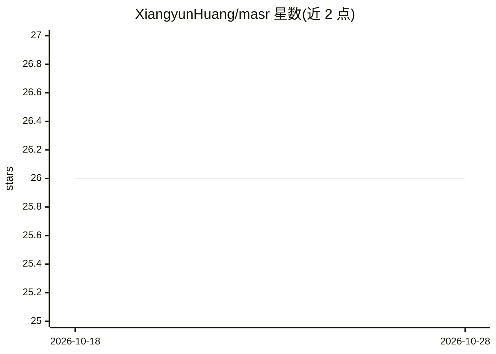

# XiangyunHuang/masr

⭐ 26 · TeX · 推送 2026-05-12 · [GitHub](https://github.com/XiangyunHuang/masr) · [官网](https://masr.netlify.app/) · 个人维护 · 中文 README

**中文统计教材：R、INLA 与 Stan 的现代应用统计**

一本开源中文书籍《现代应用统计与R语言》，内容分三大部分：机器学习（按任务类型分聚类、分类、回归、排序四章节）、贝叶斯建模（按模型种类分概率推理框架、线性模型、广义线性模型、混合效应模型、高斯过程回归等八章节）与空间分析（按空间数据类型分点模式、点参考、区域数据分析三章节）。工具上使用 R 语言及 INLA、Stan，面向学习统计建模与空间分析的读者。

## 筛选速览

| 维度 | 判定 | 备注 |
|---|---|---|
| AI 角色 | `ai-knowledge` | 知识聚合/清单类 |
| 许可风险 | `none` | — |
| 部署形态 | `None` |  |
| 模型依赖 | — | README 未给出锁定关系 |
| 硬件要求 | — | 无带数字的原话,不猜 |
| 安装摩擦 | `low` | 无编译、无系统依赖或容器化 |
| 成熟度 | — | 结构信号不足 |

## 能力要点

- 机器学习部分按任务类型组织为聚类、分类、回归、排序四章
- 贝叶斯建模覆盖概率推理框架到高斯过程回归、时间序列回归等八个章节
- 空间分析按点模式、点参考、区域数据三种类型展开

## 适用场景

- 系统学习 R 语言下的机器学习与贝叶斯建模
- 学习空间数据的统计建模方法
- 作为概率编程（INLA/Stan）的中文参考资料

## 场景标签

`教程课程` · 领域:学习与行业

## 证据(README 行号)

> L1: # 《现代应用统计与R语言》
> L5: 本书分三大部分，分别是机器学习、贝叶斯建模和空间分析。三个部分分别依据任务类型、模型种类和数据类型展开，不同的写作出发点将呈现不一样的写作风格。

## 星数曲线

2026-10-18 26 → 2026-10-28 26（+0）

---
*卡片 v1 · prompt 1.4 · 生成 2026-10-26 · 置信度 high · 依据 README sha `4c5bd8ffa553` · [字段定义](../../DATASET.md)*
