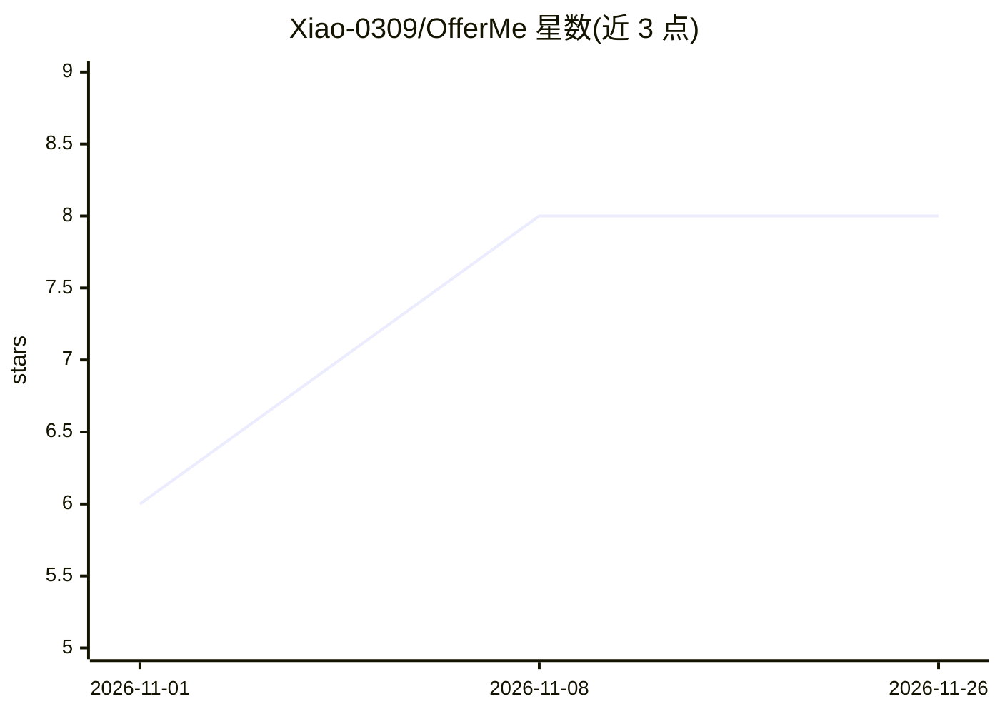

# Xiao-0309/OfferMe

⭐ 8 · TypeScript · Apache-2.0 · 推送 2026-10-31 · [GitHub](https://github.com/Xiao-0309/OfferMe) · 个人维护 · 中文 README

**面向求职者的简历驱动面试练习桌面工作台**

基于 Electron 的桌面应用，把简历、目标职位和项目/论文资料整合进一个工作台：从内置题库（210 个主题、9 个方向、39 个公开来源）检索并生成带来源标注的面试题、答案要点与追问，支持本地解析 PDF/DOCX/TXT/Markdown 参考资料。实时转录需接入 ASR 提供方，回答与视觉能力分别配置 Chat Completions 兼容端点。仅支持云端 API，无本地模型，用户自带 API key；数据本地存储。提供 macOS Apple Silicon 安装包与源码运行方式。

## 筛选速览

| 维度 | 判定 | 备注 |
|---|---|---|
| AI 角色 | `ai-native` | 本体是模型或模型工具 |
| 许可风险 | `permissive` | Apache-2.0 |
| 部署形态 | `None` |  |
| 模型依赖 | — | README 未给出锁定关系 |
| 硬件要求 | — | 无带数字的原话,不猜 |
| 安装摩擦 | `low` | 无编译、无系统依赖或容器化 |
| 成熟度 | — | 结构信号不足 |

## 能力要点

- 检索内置题库生成带来源 ID 校验的面试题，防止模型编造来源
- 实时会议音频流式转录（兼容阿里云 Fun-ASR/Paraformer 端点）
- 本地解析参考资料并纳入 AI 上下文，不做 OCR 与联网搜索
- 半透明桌面外观、多会话工作区、可选视觉问答

## 适用场景

- 用自己简历和 JD 生成定制面试题并练习作答
- 会议或面试时对转录片段提问获取 AI 回答
- 按算法/ML 方向筛选并追踪未复习过的题目

## 场景标签

`文档解析` · 领域:知识与检索

## 证据(README 行号)

> L17: **Bring your own API keys.** No local model downloads, GPU setup, OfferMe account or bundled provider credits. Engl
> L27: |**Live transcription and answers**|Stream selected audio to an ASR provider; ask about a transcript segment or typ
> L36: The local retriever matches your materials against the built-in bank. Your answer API adapts the selected topics to

## 星数曲线

2026-11-01 6 → 2026-11-26 8（+2）

---
*卡片 v1 · prompt 1.4 · 生成 2026-11-20 · 置信度 high · 依据 README sha `9c638d867728` · [字段定义](../../DATASET.md)*
