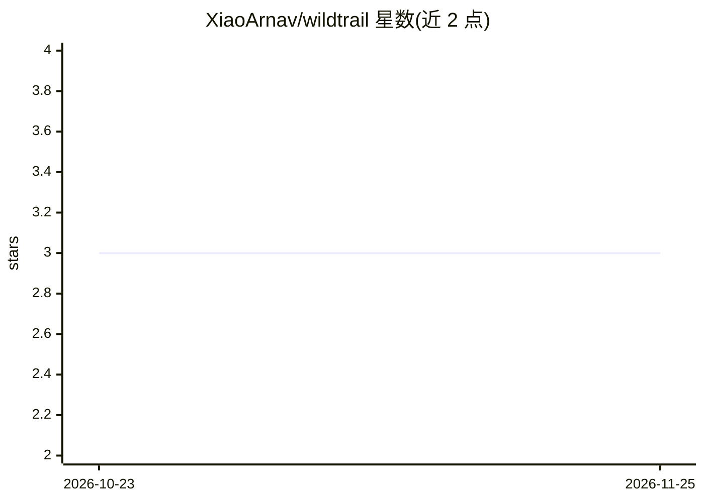

# XiaoArnav/wildtrail

⭐ — · [GitHub]() · 个人维护

**面向户外探索者的端侧野生动物识别与离线地图 PWA**

无后端的纯客户端 PWA：调用摄像头进行实时动植物识别，识别由 Transformers.js 运行的 CLIP 模型在浏览器内通过 WebGPU/Wasm 完成，照片不上传云端；观察结果铸成 3D 标本邮票并支持明信片导出；内置 MapLibre GL JS + PMTiles 离线矢量地图、RPG 式雾化探索与 GPS 轨迹记录。数据存于 IndexedDB，可导出 JSON。本地运行需以 HTTPS 或 localhost 提供静态服务，首次加载需缓存约 90 MB 模型与地图资源。

## 筛选速览

| 维度 | 判定 | 备注 |
|---|---|---|
| AI 角色 | `ai-enhanced` | 去掉 AI 部分产品仍成立 |
| 许可风险 | `permissive` | — |
| 部署形态 | `None` |  |
| 模型依赖 | — | README 未给出锁定关系 |
| 硬件要求 | — | 无带数字的原话,不猜 |
| 安装摩擦 | `low` | 无编译、无系统依赖或容器化 |
| 成熟度 | — | 结构信号不足 |

## 能力要点

- Transformers.js + CLIP 在浏览器内完成物种图像分类，WebGPU/Wasm 运行
- PMTiles 离线矢量地图包下载与 IndexedDB 持久化，支持无信号区域导航
- 纯客户端架构：无账号、无后端、无分析追踪，数据可整体导出 JSON
- 观察记录铸成 3D 标本邮票并导出收藏明信片

## 适用场景

- 徒步时识别沿途遇到的鸟类、花卉、昆虫
- 无手机信号的野外使用离线地图导航与轨迹记录
- 建立个人自然观察图鉴并分享发现明信片

## 场景标签

`目标检测` `知识库管理` · 领域:知识与检索

## 证据(README 行号)

> L37: Point your camera at any bird, flower, insect, or animal. The vision pipeline runs directly inside your device's br
> L127: |**Vision AI**|Transformers.js · CLIP `clip-vit-base-patch32`|On-device neural image classification via WebGPU/Was
> L129: |**Offline Mapping**|PMTiles · Protomaps|Local `.pmtiles` archives persisted in IndexedDB for backcountry use|

## 星数曲线

2026-10-23 3 → 2026-11-25 3（+0）

---
*卡片 v1 · prompt 1.4 · 生成 2026-11-22 · 置信度 high · 依据 README sha `1bc12acaf160` · [字段定义](../../DATASET.md)*
