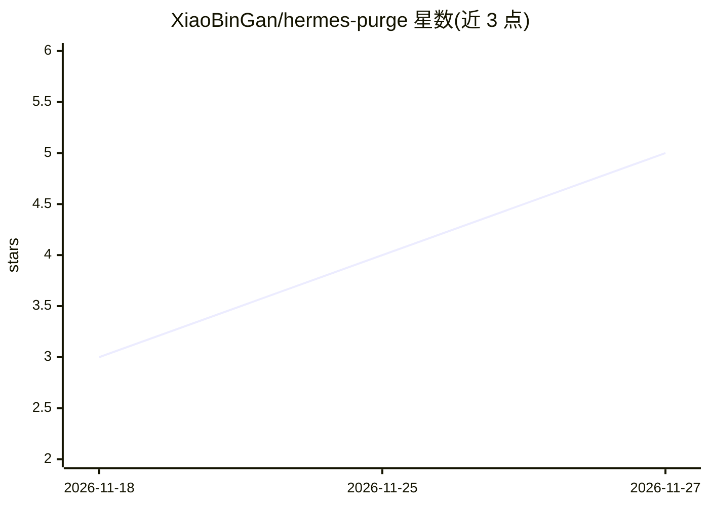

# XiaoBinGan/hermes-purge

⭐ 5 · JavaScript · MIT · 推送 2026-11-25 · [GitHub](https://github.com/XiaoBinGan/hermes-purge) · [官网](https://github.com/XiaoBinGan/hermes-purge#readme) · 个人维护 · 中文 README

**对 Hermes Agent 做三层安全机制清洗的补丁工具**

针对 Hermes Agent 0.21.3 的源码补丁工具，共 31 条补丁，分提示词（替换 SOUL.md）、配置（approvals.mode=off、.env 注入）、代码（审批门、护栏、命令黑名单等 25 处）三层，目标是关闭宿主的审批与安全检查机制。附带 hp 命令行执行器（自动判断语言与模式、被拒时进程内重采样重试）与 probe.js 边界探针（量化各类请求的单发通过率与重试收敛期望）。支持 --dry 预演、.bak 回滚与 --verify 运行时断言。补丁靠精确文本匹配定位，宿主升级后会漂移；仅在 Windows 上完整实测过。

## 筛选速览

| 维度 | 判定 | 备注 |
|---|---|---|
| AI 角色 | `ai-native` | 本体是模型或模型工具 |
| 许可风险 | `permissive` | MIT |
| 部署形态 | `library` | 以包/库形式分发 |
| 模型依赖 | — | README 未给出锁定关系 |
| 硬件要求 | — | 无带数字的原话,不猜 |
| 安装摩擦 | `low` | 无编译、无系统依赖或容器化 |
| 成熟度 | — | 结构信号不足 |

## 能力要点

- 31 条补丁覆盖提示词/配置/代码三层，附逐条锚点与说明
- hp 执行器自动判断语言与模式，拒答进程内重采样
- probe.js 量化单发通过率与重试收敛期望
- --dry 预演、.bak 回滚、--verify 八项运行时断言

## 适用场景

- 在自有授权环境中研究 agent 宿主层审批与护栏机制
- 量化测试不同类别请求在重试环下的通过率分布
- 对 Hermes Agent 源码做可回滚的批量文本补丁

## 场景标签

`网络安全` · 领域:学习与行业

## 证据(README 行号)

> L10: 对 Hermes Agent 做三层清洗：**提示词人格 / config 审批策略 / 代码层审批门与黑名单**。
> L50: **破甲执行器**：`hp` 一条命令。自动判断语言与模式，被拒自动重试，走三条通道之一。

## 星数曲线

2026-11-18 3 → 2026-11-27 5（+2）

---
*卡片 v1 · prompt 1.4 · 生成 2026-11-22 · 置信度 mid · 依据 README sha `1daa6eb34006` · [字段定义](../../DATASET.md)*
