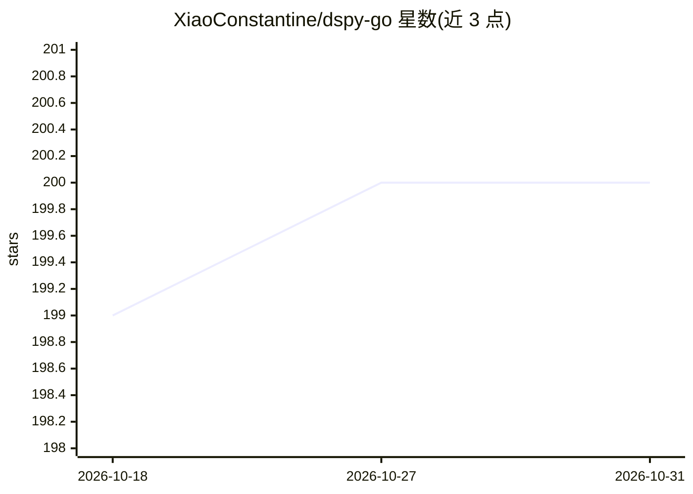

# XiaoConstantine/dspy-go

⭐ 200 · Go · MIT · 推送 2026-10-26 · [GitHub](https://github.com/XiaoConstantine/dspy-go) · [官网](https://xiaoconstantine.github.io/dspy-go/) · 个人维护

**DSPy 框架的 Go 原生实现：模块化构建 LLM 应用**

DSPy 框架的 Go 语言实现，提供系统化提示工程能力：以 Signature 定义输入输出契约，组合 Predict、ChainOfThought、ReAct、RLM 等模块构建 LLM 应用与工作流。支持多种 LLM 提供方（Anthropic、OpenAI、Gemini、Ollama、LlamaCPP），底层生成/流式/工具调用由 llm-go 库承担，pkg/llms 保留为兼容适配层；Ollama 与 llama.cpp 需暴露 OpenAI 兼容端点。附优化器（GEPA/MIPRO/SIMBA 等）、多智能体 A2A 协议、MCP 工具集成及零代码 CLI。MIT 许可。

## 筛选速览

| 维度 | 判定 | 备注 |
|---|---|---|
| AI 角色 | `ai-ecosystem` | LLM/agent 周边工具 |
| 许可风险 | `permissive` | MIT |
| 部署形态 | `None` |  |
| 模型依赖 | local-ok | 支持本地模型 |
| 硬件要求 | — | 无带数字的原话,不猜 |
| 安装摩擦 | `low` | 无编译、无系统依赖或容器化 |
| 成熟度 | — | 结构信号不足 |

## 能力要点

- Predict/ChainOfThought/ReAct/RLM/Refine/Parallel 等可组合模块
- GEPA、MIPRO、SIMBA、BootstrapFewShot、COPRO 优化器
- 多智能体 A2A 协议与 MCP 工具集成、贝叶斯工具选择
- 提供零代码 CLI（列出/试用优化器、查看会话日志）

## 适用场景

- 在 Go 项目中以模块组合方式构建 LLM 应用与 Agent 工作流
- 对提示程序运行优化器提升输出质量
- 多智能体编排与工具调用编排

## 场景标签

`Agent 框架` `多智能体` `提示工程` · 领域:Agent 开发

## 证据(README 行号)

> L9: DSPy-Go is a native Go implementation of the DSPy framework, bringing systematic prompt engineering and automated re
> L23: |**Quality Optimizers**|GEPA, MIPRO, SIMBA, BootstrapFewShot, COPRO|

## 星数曲线

2026-10-18 199 → 2026-10-31 200（+1）

---
*卡片 v1 · prompt 1.4 · 生成 2026-10-22 · 置信度 high · 依据 README sha `6f47bb40c4e9` · [字段定义](../../DATASET.md)*
