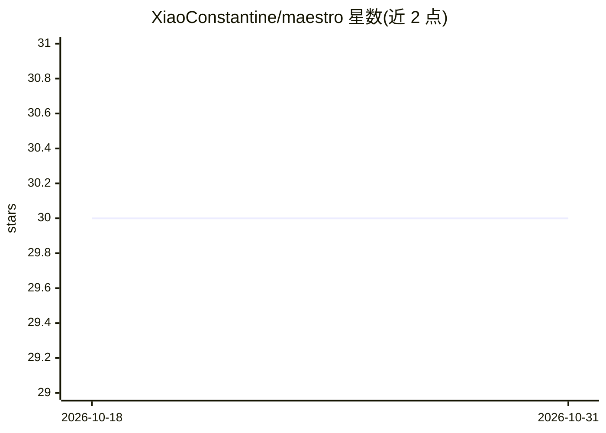

# XiaoConstantine/maestro

⭐ 30 · Go · MIT · 推送 2026-07-29 · [GitHub](https://github.com/XiaoConstantine/maestro) · 个人维护

**基于 dspy-go 的本地 AI 代码评审与仓库问答助手**

用 Go 实现的 AI 代码评审与仓库分析 CLI/TUI，构建在 dspy-go 之上：分块并行评审 PR 并输出行级定位的发现、抑制低价值评论、通过 GitHub token 直接评审 PR 并感知已有评论；提供 /ask 仓库问答、带 ls/read/write/edit 工具的工作区编码会话（bash 需显式授权）、sgrep 语义检索。另含离线 GEPA 调优与 evolve-review 自进化命令，优化产物可被实时评审路径加载。模型后端经 dspy-go 提供者抽象接入，支持本地 OpenAI 兼容端点与 ChatGPT 订阅登录。需 Go 1.24+ 源码构建，当前调优面向 Go 语言发现。

## 筛选速览

| 维度 | 判定 | 备注 |
|---|---|---|
| AI 角色 | `ai-native` | 本体是模型或模型工具 |
| 许可风险 | `permissive` | MIT |
| 部署形态 | `None` |  |
| 模型依赖 | — | README 未给出锁定关系 |
| 硬件要求 | — | 无带数字的原话,不猜 |
| 安装摩擦 | `low` | 无编译、无系统依赖或容器化 |
| 成熟度 | `idea` | |

## 能力要点

- 分块并行 PR 评审，行级定位发现并过滤低价值评论
- TUI 编码会话：ls/read/write/edit 工具，bash 需显式 --allow-coding-bash
- offline GEPA 调优与 evolve-review 自进化循环，产物可被实时评审加载
- 经 dspy-go 提供者层支持多模型与本地 OpenAI 兼容端点、ChatGPT 订阅 OAuth 登录

## 适用场景

- 在终端里对 GitHub PR 跑 AI 评审并发布评论
- 用自然语言询问代码库问题或直接在工作区编辑代码
- 离线跑基准调优并让评审器持续进化

## 场景标签

`代码审查` `编码 Agent` · 领域:编码与开发

## 证据(README 行号)

> L3: Maestro is an AI code review and repository analysis assistant built on top of `dspy-go`. It is no longer just a one
> L24: - **Specialized PR Review Agent**: Maestro uses a dedicated Go review path rather than a generic chat wrapper.

## 星数曲线

2026-10-18 30 → 2026-10-31 30（+0）

---
*卡片 v1 · prompt 1.4 · 生成 2026-10-26 · 置信度 high · 依据 README sha `6ec312627e55` · [字段定义](../../DATASET.md)*
