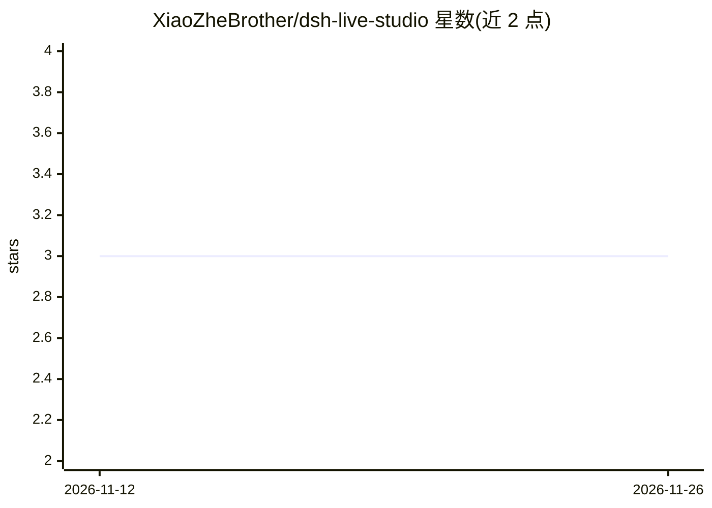

# XiaoZheBrother/dsh-live-studio

⭐ 3 · Python · MIT · 推送 2026-11-15 · [GitHub](https://github.com/XiaoZheBrother/dsh-live-studio) · 个人维护 · 中文 README

**让 AI Agent 成为 B 站虚拟主播的 DSH 插件**

DeepSeek Harness (DSH) 的虚拟主播插件：接收 B 站直播弹幕并合并同一观众的问题，生成语音回复（当前使用 Edge TTS），由 Agent 控制 Live2D 表情与动作，输出浏览器直播画面源，并用 SQLite 账本记录模型消耗与礼物金额。需要 Node.js 22.19+ 与 Python 3.11+，模型与 Cubism Core 需自行取得，不自动点击开播。当前为 0.2.0-alpha.4 开发预览，默认关闭，真实直播验收未完成。

## 筛选速览

| 维度 | 判定 | 备注 |
|---|---|---|
| AI 角色 | `ai-native` | 本体是模型或模型工具 |
| 许可风险 | `permissive` | MIT |
| 部署形态 | `desktop` | 安装包/桌面程序 |
| 模型依赖 | — | README 未给出锁定关系 |
| 硬件要求 | — | 无带数字的原话,不猜 |
| 安装摩擦 | `low` | 无编译、无系统依赖或容器化 |
| 成熟度 | `idea` | |

## 能力要点

- 弹幕接收、问题合并、语音回复与账本记录的直播流水线
- Agent 通过 live2d_catalog/live2d_perform 工具控制 Live2D 表情与动作
- 内置网页版 Live2D 舞台，口型由语音音量驱动，输出浏览器素材源
- 相同 home 与直播间有进程锁，写接口保留回环、同源与令牌校验

## 适用场景

- 让 Agent 接管 B 站直播间的弹幕互动与语音回复
- 用 Live2D 舞台作为直播软件的浏览器素材画面
- 记录直播中的模型 API 消耗与礼物收入账本

## 场景标签

`语音合成` `聊天机器人` · 领域:对话与助手

## 证据(README 行号)

> L5: A DeepSeek Harness (DSH) plugin for Bilibili live chat, text-to-speech replies, agent-controlled Live2D expressions 
> L35: 这是一个独立的 DSH 虚拟主播插件：接收 B 站直播弹幕、合并同一观众的问题、生成语音、内置 Live2D 舞台、输出浏览器直播画面，并记录模型消耗与礼物金额。
> L37: 当前为 **0.2.0-alpha.4 开发预览**，源码已公开，尚未完成全新 DSH 启动和真实直播验收。不会替你点击开播，不包含模型素材。默认关闭。

## 星数曲线

2026-11-12 3 → 2026-11-26 3（+0）

---
*卡片 v1 · prompt 1.4 · 生成 2026-11-22 · 置信度 high · 依据 README sha `a269f7018b31` · [字段定义](../../DATASET.md)*
