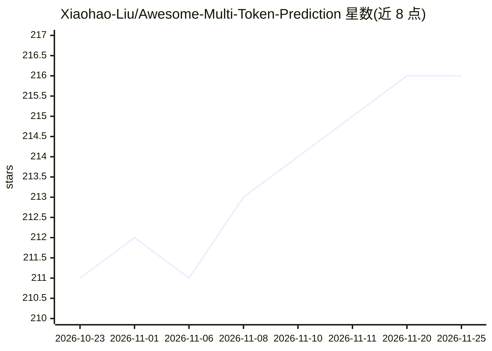

# Xiaohao-Liu/Awesome-Multi-Token-Prediction

⭐ 216 · 推送 2026-10-30 · [GitHub](https://github.com/Xiaohao-Liu/Awesome-Multi-Token-Prediction) · 个人维护

**面向研究者的多 Token 预测（MTP）论文与资源清单**

一个关于多 Token 预测（MTP）的策展清单，收录 LLM、语音-语言模型等方向的相关论文、工具与资源，按年份分为 2026、2025 近期论文、早期奠基工作以及推测解码（Speculative Decoding）+MTP 专区，每条条目标注机构、发表载体、论文与代码链接。收录规则声明仅在会议官方程序或论文元数据确认时才标注 venue，未发表作品标注为 arXiv 预印本。通过 PR 与 issue 接受社区补充。

## 筛选速览

| 维度 | 判定 | 备注 |
|---|---|---|
| AI 角色 | `ai-knowledge` | 知识聚合/清单类 |
| 许可风险 | `none` | — |
| 部署形态 | `None` |  |
| 模型依赖 | — | README 未给出锁定关系 |
| 硬件要求 | — | 无带数字的原话,不猜 |
| 安装摩擦 | `low` | 无编译、无系统依赖或容器化 |
| 成熟度 | — | 结构信号不足 |

## 能力要点

- 按 2026/2025/早期工作/推测解码四个板块组织论文条目
- 每条论文标注机构、venue、论文与代码链接
- 声明 venue 信息仅在官方程序或元数据确认后才标注

## 适用场景

- 调研 MTP 与推测解码方向的研究进展
- 为 LLM 推理加速研究查找相关论文与开源实现
- 追踪语音-语言模型中的多 Token 预测应用

## 场景标签

`精选清单` · 领域:学习与行业

## 证据(README 行号)

> L3: > *A curated list of papers, tools, and resources on Multi-Token Prediction (MTP) and related techniques in Large La
> L9: ## 🔬 Recent Papers (2026)

## 星数曲线

2026-10-23 211 → 2026-11-25 216（+5）

---
*卡片 v1 · prompt 1.4 · 生成 2026-11-25 · 置信度 high · 依据 README sha `c3934c8cd851` · [字段定义](../../DATASET.md)*
