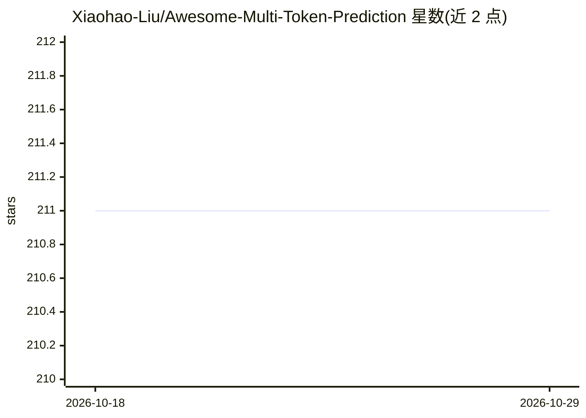

# Xiaohao-Liu/Awesome-Multi-Token-Prediction

⭐ 211 · 推送 2026-09-08 · [GitHub](https://github.com/Xiaohao-Liu/Awesome-Multi-Token-Prediction) · 个人维护

**多Token预测（MTP）方向的论文与资源策展清单**

收集 Multi-Token Prediction（MTP）及相关技术的论文、工具与资源，覆盖 LLM、语音语言模型等方向。按年份（2026/2025/更早）与主题（推测解码+MTP）组织成表格，条目含标题、机构、发表会议、论文链接与代码链接；会议信息仅在官方渠道确认后标注，未发表工作标记为 arXiv 预印本或技术报告。面向 LLM 训练与推理加速方向的研究者，接受社区 PR 贡献。

## 筛选速览

| 维度 | 判定 | 备注 |
|---|---|---|
| AI 角色 | `ai-knowledge` | 知识聚合/清单类 |
| 许可风险 | `none` | — |
| 部署形态 | `None` |  |
| 模型依赖 | — | README 未给出锁定关系 |
| 硬件要求 | — | 无带数字的原话,不猜 |
| 安装摩擦 | `low` | 无编译、无系统依赖或容器化 |
| 成熟度 | — | 结构信号不足 |

## 能力要点

- 按年份分节的论文表格（2026/2025/早期工作）
- 条目含机构、会议、论文与代码链接
- 单设 Speculative Decoding + MTP 主题章节
- 贡献需遵循统一格式与链接规范

## 适用场景

- 查找 MTP 与推测解码方向的论文及代码实现
- 跟踪各机构在多Token预测方向的发表情况
- 了解 MTP 从早期工作到最新进展的技术脉络

## 场景标签

`精选清单` · 领域:学习与行业

## 证据(README 行号)

> L3: > *A curated list of papers, tools, and resources on Multi-Token Prediction (MTP) and related techniques in Large La
> L5: Multi-Token Prediction (MTP) is an emerging paradigm that enhances the efficiency and capability of language and mul

## 星数曲线

2026-10-18 211 → 2026-10-29 211（+0）

---
*卡片 v1 · prompt 1.4 · 生成 2026-10-22 · 置信度 high · 依据 README sha `f3d82cba5f04` · [字段定义](../../DATASET.md)*
