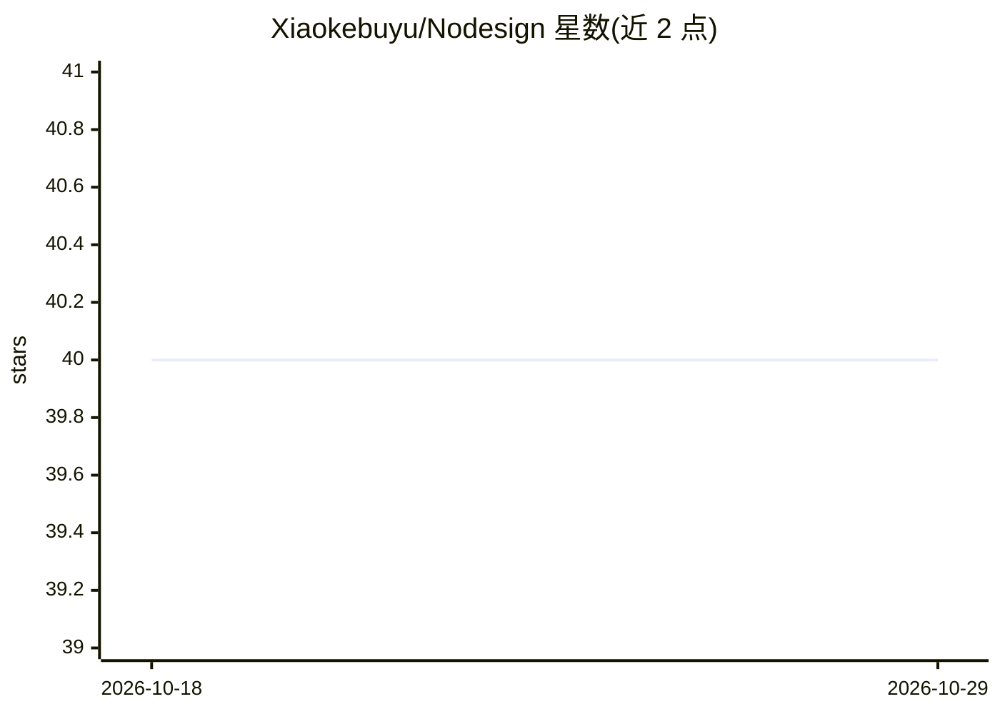

# Xiaokebuyu/Nodesign

⭐ 40 · JavaScript · AGPL-3.0 · 推送 2026-10-11 · [GitHub](https://github.com/Xiaokebuyu/Nodesign) · [官网](https://nodesign.xiaobuyu.trade/welcome/) · 个人维护 · 中文 README

**以无限画布为共同工作台的 Agent 创作工具，生成网站/演示稿/文档**

面向终端用户的桌面/网页应用：用户在画布上放置、圈选、连线整理素材与指令，Agent 在同一画布上制作网站、演示稿、Word 文档、图像与视频，产物以标准文件交付。支持 Windows 桌面版（Electron）、网页版与命令行版（npx），本地数据存于本机。模型可登录 NoDesign 账号使用平台免费额度，或以 BYOK 接入 DeepSeek、Anthropic、Ollama 等服务商。处于公开测试阶段，macOS 桌面版暂未提供。

## 筛选速览

| 维度 | 判定 | 备注 |
|---|---|---|
| AI 角色 | `ai-native` | 本体是模型或模型工具 |
| 许可风险 | `viral` | AGPL-3.0 |
| 部署形态 | `library` | 以包/库形式分发 |
| 模型依赖 | local-ok | 支持本地模型 |
| 硬件要求 | — | 无带数字的原话,不猜 |
| 安装摩擦 | `medium` | 含编译或系统依赖之一 |
| 成熟度 | `idea` | |

## 能力要点

- 画布同时充当用户指令面与 Agent 的桌面/眼睛/黑板
- 支持网站、演示稿、Word 文档、图像、视频五类产物及标准文件导出
- BYOK 接入国内外多家服务商与本机模型（Ollama、LM Studio），请求本机直发
- 本地版提供 MCP 服务端，Claude Code 等外部 Agent 可读取运行状态

## 适用场景

- 在画布上让 Agent 制作品牌官网、演示稿与品牌手册
- 跨产物取材修改：从画布上的文档提取内容加入演示稿
- 本地优先使用自有 API Key 运行 Agent 创作流程

## 场景标签

`AI 助手` `AI 写作` `图像生成` `视频生成` · 领域:对话与助手

## 证据(README 行号)

> L8: 用户在画布上指定、整理与修改，Agent 在画布上制作、检查与说明。产物以标准文件交付。
> L59: - **自动检查**：交付前获取桌面、平板与手机三种宽度的截图，读取控制台错误、渲染样式与字体加载状态；多轮修改仍未达到预期时，可调用只读评审子代理逐页复核。
> L222: - **模型兼容**：原生支持 Claude，并通过格式转换接入兼容 OpenAI API 的模型服务。无法匹配上游时直接返回错误，避免请求被发送至错误的服务。

## 星数曲线

2026-10-18 40 → 2026-10-29 40（+0）

---
*卡片 v1 · prompt 1.4 · 生成 2026-10-25 · 置信度 high · 依据 README sha `8d488c9c650f` · [字段定义](../../DATASET.md)*
