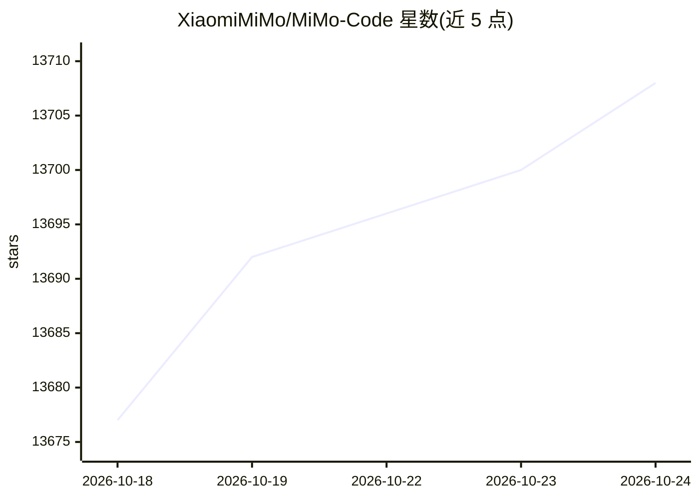

# XiaomiMiMo/MiMo-Code

⭐ 13,718 · TypeScript · MIT · 推送 2026-10-23 · [GitHub](https://github.com/XiaomiMiMo/MiMo-Code) · [官网](https://mimo.xiaomi.com/mimocode) · 组织维护 · 中文 README

**面向开发者的终端原生 AI 编码助手，带持久记忆与多 Agent**

终端（TUI）内运行的 AI 编码助手：读写代码、执行命令、管理 Git，并通过 SQLite FTS5 驱动的跨会话持久记忆（项目记忆、会话检查点、任务日志）保持对项目的理解。内置 build/plan 双 Agent、子 Agent 并行、目标停止条件判定、JavaScript 工作流（deep-research、fact-check 等 3 个内置）与技能系统（arxiv、pdf、pptx 等内置技能）。可通过 OAuth 或 API key 连接多家 LLM 提供商，另可迁移 Claude Code 认证；附带以 MiMo Code 为核心引擎的桌面版。安装提供 macOS/Linux 一行脚本；macOS 不支持自带 Terminal.app。

## 筛选速览

| 维度 | 判定 | 备注 |
|---|---|---|
| AI 角色 | `ai-native` | 本体是模型或模型工具 |
| 许可风险 | `permissive` | MIT |
| 部署形态 | `None` |  |
| 模型依赖 | — | README 未给出锁定关系 |
| 硬件要求 | — | 无带数字的原话,不猜 |
| 安装摩擦 | `medium` | 含编译或系统依赖之一 |
| 成熟度 | — | 结构信号不足 |

## 动量与使用信号

- 维护:`active` — 距上次 push 0.7 天,年发版 2,18 位贡献者
- 涨星:近 1 天 **+10**(自 20261016 起算)
- 平台:WINDOWS / MACOS / LINUX · 协议:OPENAI-API / MCP

## 能力要点

- SQLite FTS5 跨会话持久记忆，会话恢复自动注入上下文
- 多 Agent 与子 Agent 并行，/goal 独立裁判模型判定停止条件
- JavaScript 编写的确定性工作流 + BM25 技能检索系统
- 上下文预算管理与按模型的 /context-limit 压缩点调节

## 适用场景

- 在终端里让 AI 助手完成编码、测试与 Git 操作
- 跨会话维护对同一项目的长期记忆与任务进度
- 用内置工作流生成带引用的深度研究报告或做事实核查
- 运行可机械验证指标的自主优化实验循环

## 场景标签

`编码 Agent` `Agent 记忆` `多智能体` · 领域:Agent 开发

## 证据(README 行号)

> L11: MiMoCode is a terminal-native AI coding assistant. It can read and write code, run commands, manage Git, and use a 
> L29: MiMoCode supports connecting to any mainstream LLM provider API.
> L19: Xiaomi MiMo Desktop is built for real-world work: one conversation can handle office work, design, coding, and mult

## 星数曲线

2026-10-18 13,677 → 2026-10-24 13,708（+31）

---
*卡片 v1 · prompt 1.4 · 生成 2026-10-18 · 置信度 high · 依据 README sha `9745a768986e` · [字段定义](../../DATASET.md)*
