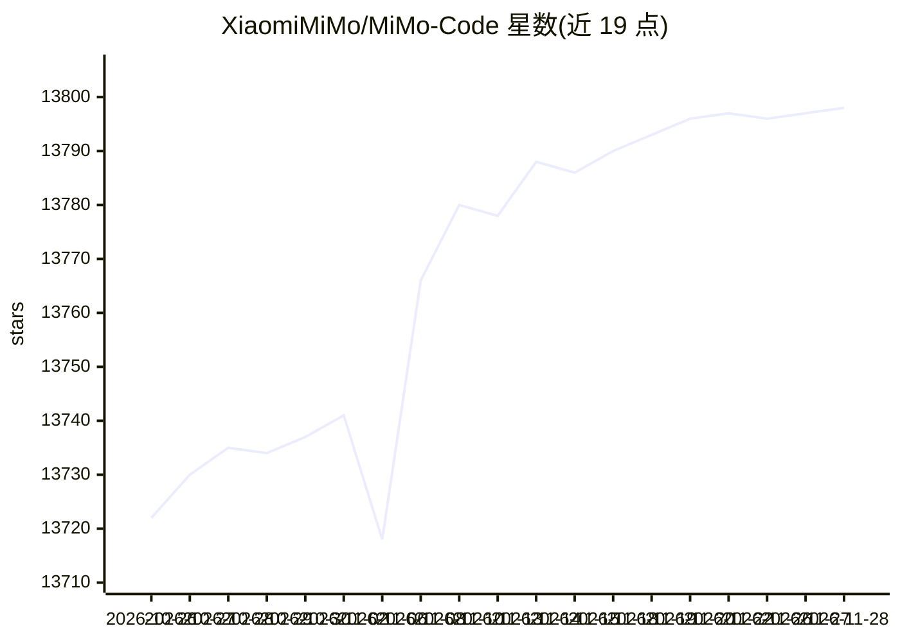

# XiaomiMiMo/MiMo-Code

⭐ 13,798 · TypeScript · MIT · 推送 2026-11-27 · [GitHub](https://github.com/XiaomiMiMo/MiMo-Code) · [官网](https://mimo.xiaomi.com/mimocode) · 组织维护 · 中文 README

**终端原生的 AI 编码助手：读写代码、管理 Git 并跨会话保持项目记忆**

MiMoCode 是小米 MiMo 团队开发的终端 AI 编码助手，可读写代码、运行命令、管理 Git，通过 SQLite FTS5 支撑的跨会话记忆系统持续理解项目并提供 checkpointer/上下文重建机制。核心功能含 build/plan 多 Agent、并行子代理、树形任务跟踪、/goal 停止条件判定、沙箱化 JS 工作流（deep-research、fact-check、research-experiment）及内置技能（PDF 生成、arXiv 检索、论文写作等）。支持 OAuth/API key 接入多家模型服务商，并可一行脚本安装于 macOS/Linux。

## 筛选速览

| 维度 | 判定 | 备注 |
|---|---|---|
| AI 角色 | `ai-native` | 本体是模型或模型工具 |
| 许可风险 | `permissive` | MIT |
| 部署形态 | `None` |  |
| 模型依赖 | — | README 未给出锁定关系 |
| 硬件要求 | — | 无带数字的原话,不猜 |
| 安装摩擦 | `medium` | 含编译或系统依赖之一 |
| 成熟度 | — | 结构信号不足 |

## 动量与使用信号

- 维护:`active` — 距上次 push 0.7 天,年发版 2,18 位贡献者
- 涨星:近 1 天 **+10**(自 20261016 起算)
- 平台:WINDOWS / MACOS / LINUX · 协议:OPENAI-API / MCP

## 能力要点

- SQLite FTS5 跨会话持久记忆：项目记忆、检查点、笔记、任务日志
- 多 Agent（build/plan）、并行子代理与 /goal 停止条件独立判定
- 三个内置 JS 工作流：deep-research、fact-check、research-experiment
- 自动上下文压缩点调整（/context-limit）与技能系统（BM25 匹配）

## 适用场景

- 在终端里让 AI 助手直接完成编码、Git 管理与多文件迭代
- 用 deep-research/fact-check 工作流产出带引用的研究或核查报告
- 自主优化循环（research-experiment）验证可机械评估的指标
- 跨会话续接开发任务，无需重新学习项目上下文

## 场景标签

`编码 Agent` `多智能体` · 领域:Agent 开发

## 证据(README 行号)

> L11: MiMoCode is a terminal-native AI coding assistant. It can read and write code, run commands, manage Git, and use a 
> L21: Xiaomi MiMo Desktop is built for real-world work: one conversation can handle office work, design, coding, and mult
> L111: ### Multiple Agents

## 星数曲线

2026-10-26 13,722 → 2026-11-28 13,798（+76）

---
*卡片 v1 · prompt 1.4 · 生成 2026-11-28 · 置信度 high · 依据 README sha `5963a0faa036` · [字段定义](../../DATASET.md)*
