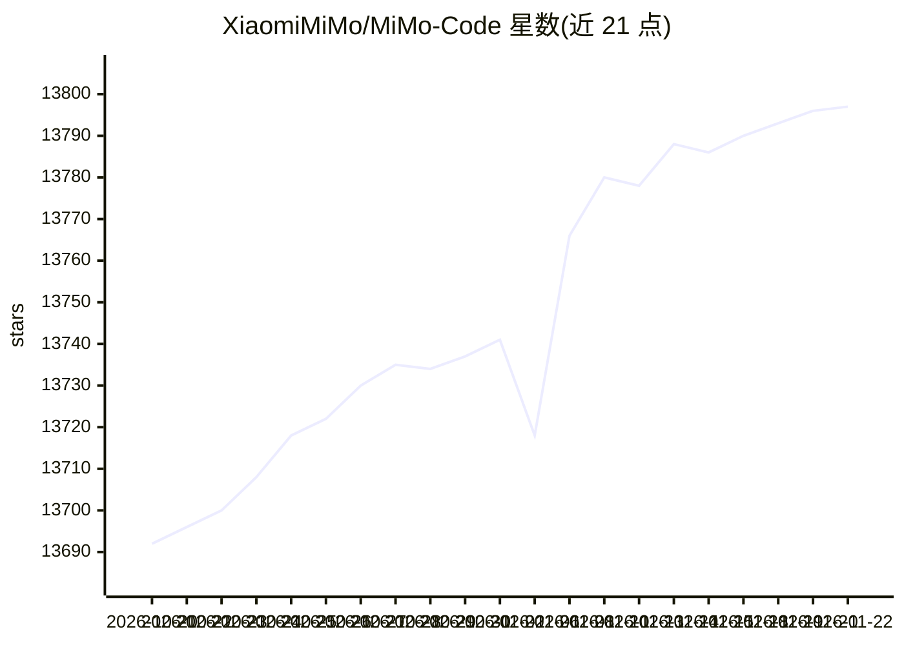

# XiaomiMiMo/MiMo-Code

⭐ 13,797 · TypeScript · MIT · 推送 2026-11-21 · [GitHub](https://github.com/XiaomiMiMo/MiMo-Code) · [官网](https://mimo.xiaomi.com/mimocode) · 组织维护 · 中文 README

**小米出品的终端原生 AI 编程助手 CLI，跨会话记忆持续理解项目**

MiMoCode 是小米 MiMo 团队发布的终端原生 AI 编码助手：可读写代码、执行命令、管理 Git，并通过基于 SQLite FTS5 的持久记忆系统（MEMORY.md、checkpoint、notes、任务日志）在会话间保持对项目的理解。支持连接任意主流 LLM 提供商 API（OAuth 或 OpenAI 兼容自定义 Provider），内置 build/plan 双 Agent、子代理并行、上下文压缩与任务跟踪、确定性 JavaScript 工作流（deep-research/fact-check/research-experiment）与可复用技能系统。提供 macOS/Linux 一键安装脚本；不支持 macOS 内置终端，需 iTerm2 或 VS Code 终端。

## 筛选速览

| 维度 | 判定 | 备注 |
|---|---|---|
| AI 角色 | `ai-ecosystem` | LLM/agent 周边工具 |
| 许可风险 | `permissive` | MIT |
| 部署形态 | `None` |  |
| 模型依赖 | — | README 未给出锁定关系 |
| 硬件要求 | — | 无带数字的原话,不猜 |
| 安装摩擦 | `medium` | 含编译或系统依赖之一 |
| 成熟度 | — | 结构信号不足 |

## 动量与使用信号

- 维护:`active` — 距上次 push 0.7 天,年发版 2,18 位贡献者
- 涨星:近 1 天 **+10**(自 20261016 起算)
- 平台:WINDOWS / MACOS / LINUX · 协议:OPENAI-API / MCP

## 能力要点

- 跨会话持久记忆：SQLite FTS5 检索的项目记忆、会话检查点与任务日志
- 上下文管理：自动检查点、上下文重建、token 预算注入与可调压缩点 /context-limit
- 确定性 JS 工作流：deep-research、fact-check、research-experiment，支持沙箱并行与文件断点续跑
- 可从 Claude Code 一键迁移认证，支持任意 OpenAI 兼容 API

## 适用场景

- 在终端中让 AI 代理读写代码、跑命令、管理 Git 完成开发任务
- 长会话开发中保留项目知识，恢复会话不丢上下文
- 用内置工作流做多来源深度研究报告或事实核查
- 在 Cursor/Cline/Zed 等工具中接入 MiMo 模型（配套指南仓库）

## 场景标签

`编码 Agent` · 领域:编码与开发

## 证据(README 行号)

> L11: MiMoCode is a terminal-native AI coding assistant. It can read and write code, run commands, manage Git, and use a 
> L13: MiMoCode supports connecting to any mainstream LLM provider API.
> L105: Beyond MiMoCode, Xiaomi MiMo models also work in other agents and coding tools like Cursor, Cline, and Zed.

## 星数曲线

2026-10-20 13,692 → 2026-11-22 13,797（+105）

---
*卡片 v1 · prompt 1.4 · 生成 2026-11-22 · 置信度 high · 依据 README sha `68e5edd9ad48` · [字段定义](../../DATASET.md)*
