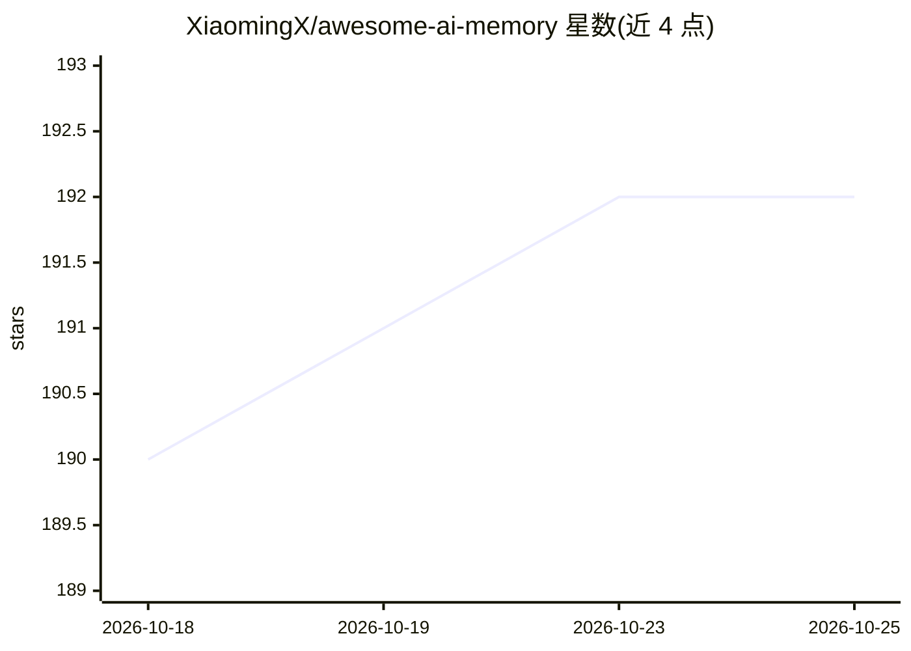

# XiaomingX/awesome-ai-memory

⭐ 192 · Apache-2.0 · 推送 2026-10-06 · [GitHub](https://github.com/XiaomingX/awesome-ai-memory) · [官网](https://x.com/seclink) · 个人维护 · 中文 README

**LLM 长期记忆项目与论文的中文精选清单**

以中文维护的大语言模型长期记忆（Long-term Memory）策展清单：按 13 个板块组织收录项目，覆盖聚合记忆层、Agent 与本地记忆工具、框架集成、向量/图数据库、MCP 记忆插件、多模态一致性、分布式训练、多代理协同、在线对齐与持续学习等。另梳理 RAG→MemGPT→GraphRAG→Mem0→Titans→AgeMem 的技术演进脉络与 2026 年新论文、评测基准（MemoryAgentBench、MemoryArena 等），并给出按场景（叙事、隐私、生态兼容）的选型建议。不提供可安装的本体软件，仅作目录与文档。

## 筛选速览

| 维度 | 判定 | 备注 |
|---|---|---|
| AI 角色 | `ai-knowledge` | 知识聚合/清单类 |
| 许可风险 | `permissive` | Apache-2.0 |
| 部署形态 | `None` |  |
| 模型依赖 | — | README 未给出锁定关系 |
| 硬件要求 | — | 无带数字的原话,不猜 |
| 安装摩擦 | `low` | 无编译、无系统依赖或容器化 |
| 成熟度 | — | 结构信号不足 |

## 能力要点

- 13 个板块分类组织记忆相关开源/商业项目
- 含 2026 年新论文与 11 个记忆评测基准的跟踪
- 附技术演进鱼骨图与按场景的选型建议

## 适用场景

- 为 AI agent 项目挑选长期记忆层方案
- 跟踪记忆方向的新论文与评测基准
- 了解从 RAG 到可学习记忆管理的技术演进脉络

## 场景标签

`精选清单` `Agent 记忆` · 领域:Agent 开发

## 证据(README 行号)

> L1: # Awesome AI Memory - 大语言模型长期记忆项目精选列表
> L3: 这是一个专注于大语言模型（LLM）长期记忆（Long-term Memory）实现的精选列表，覆盖从底层检索/存储范式、记忆层系统、Agent 记忆工具，到多模态一致性、训练与对齐的完整生态。

## 星数曲线

2026-10-18 190 → 2026-10-25 192（+2）

---
*卡片 v1 · prompt 1.4 · 生成 2026-10-22 · 置信度 high · 依据 README sha `288bee5e1599` · [字段定义](../../DATASET.md)*
