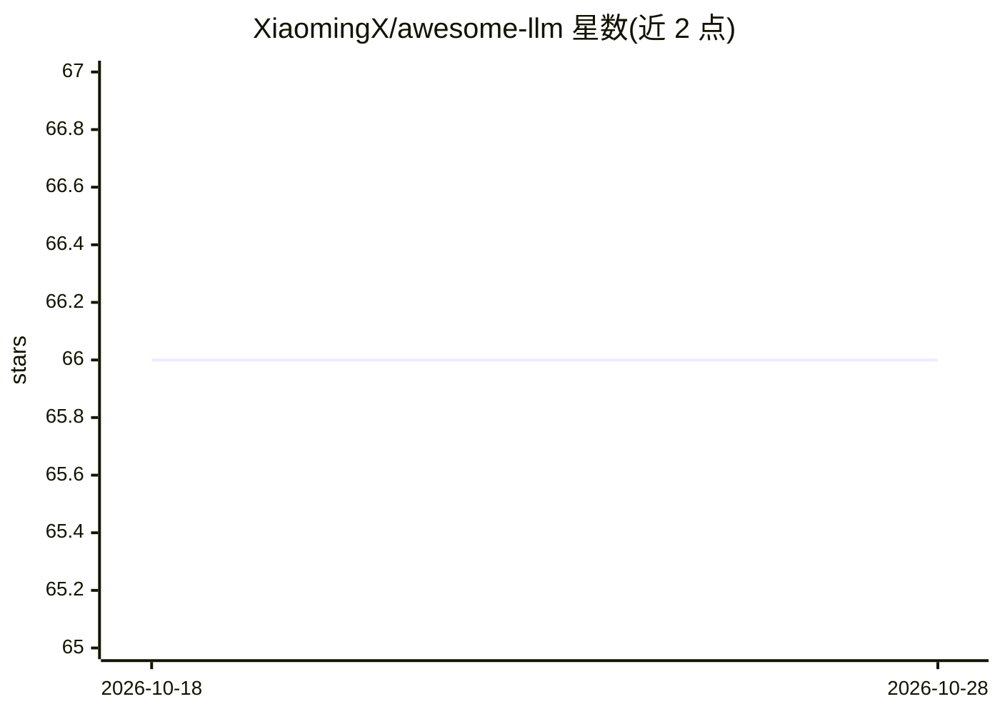

# XiaomingX/awesome-llm

⭐ 66 · Python · Apache-2.0 · 推送 2026-02-03 · [GitHub](https://github.com/XiaomingX/awesome-llm) · [官网](https://x.com/seclink) · 个人维护 · 中文 README

**LLM 研究论文、工具与模型检查点的策展清单**

面向 LLM 学习与选型读者的策展清单：按时间线整理 2017-2025 年重要论文（Transformers、GPT 系列、LLaMA、DeepSeek-R1 等），并分类收录开源模型、训练框架（Unsloth、Llama-Factory 等）、推理引擎与网关（vLLM、llama.cpp、LiteLLM 等）、Agent 平台、多模态预训练与强化学习资源，另附排行榜与教程课程。条目为链接列表形式，不含可运行代码。

## 筛选速览

| 维度 | 判定 | 备注 |
|---|---|---|
| AI 角色 | `ai-knowledge` | 知识聚合/清单类 |
| 许可风险 | `permissive` | Apache-2.0 |
| 部署形态 | `None` |  |
| 模型依赖 | — | README 未给出锁定关系 |
| 硬件要求 | — | 无带数字的原话,不猜 |
| 安装摩擦 | `low` | 无编译、无系统依赖或容器化 |
| 成熟度 | — | 结构信号不足 |

## 能力要点

- 按时间线整理 2017-2025 年 LLM 重要论文里程碑
- 覆盖训练框架、推理引擎、推理网关、Agent 平台等工具分类
- 收录开源模型检查点（Llama、DeepSeek、Qwen、Mistral 等）与排行榜
- 包含多模态预训练、强化学习与具身智能资源

## 适用场景

- 系统了解 LLM 发展脉络与关键论文
- 选型时查找训练、部署、推理工具
- 查找开源模型检查点与评测排行榜

## 场景标签

`精选清单` · 领域:学习与行业

## 证据(README 行号)

> L1: # Awesome LLM (大型语言模型)
> L3: 🔥 大型语言模型（LLM）持续引领全球 AI 浪潮，已从通用的对话模型进化为具备深度推理（Reasoning）和自主行动（Agentic）能力的智能体。这里整理了关于大型语言模型，特别是与 ChatGPT、Claude、DeepSe
> L96: ## LLM训练框架

## 星数曲线

2026-10-18 66 → 2026-10-28 66（+0）

---
*卡片 v1 · prompt 1.4 · 生成 2026-10-24 · 置信度 high · 依据 README sha `36e7ffc4537e` · [字段定义](../../DATASET.md)*
