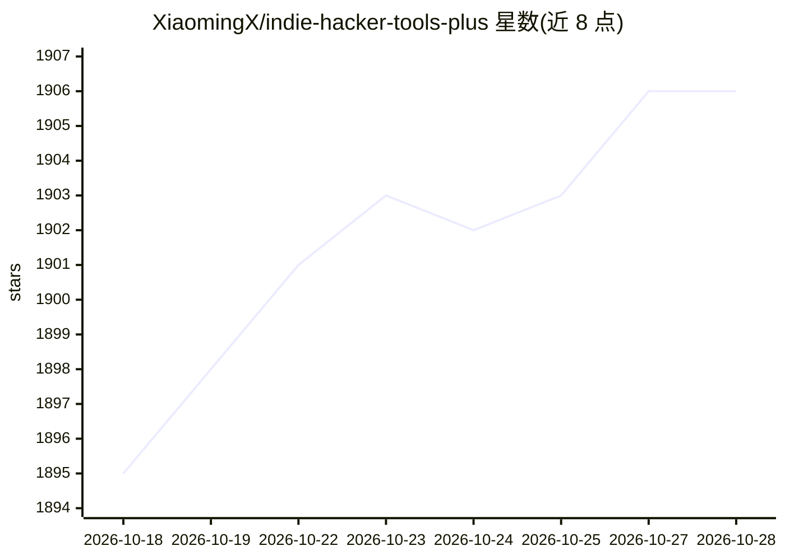

# XiaomingX/indie-hacker-tools-plus

⭐ 1,906 · Apache-2.0 · 推送 2026-10-27 · [GitHub](https://github.com/XiaomingX/indie-hacker-tools-plus) · [官网](https://twitter.com/seclink) · 个人维护 · 中文 README

**面向独立开发者出海的精选工具与技术栈清单**

一个 awesome-list 类的策展仓库，面向独立开发者与出海团队，按类别收录工具与平台：Web 开发模板、后端云、数据库、云基础设施、可观测性、邮件营销、支付金融、零工招聘等，并含'AI 时代全栈工具链'章节（LLM 评测、Agent/MCP 生态、AI 编辑器、向量数据库、AI 算力网关等）。条目以表格呈现工具名加一句备注，通过 issue/PR 接受投稿。内容为清单本身，不含可安装运行的代码。

## 筛选速览

| 维度 | 判定 | 备注 |
|---|---|---|
| AI 角色 | `ai-knowledge` | 知识聚合/清单类 |
| 许可风险 | `permissive` | Apache-2.0 |
| 部署形态 | `None` |  |
| 模型依赖 | — | README 未给出锁定关系 |
| 硬件要求 | — | 无带数字的原话,不猜 |
| 安装摩擦 | `low` | 无编译、无系统依赖或容器化 |
| 成熟度 | — | 结构信号不足 |

## 能力要点

- 覆盖 Web 开发、云基础设施、支付金融、营销等出海工具类目
- 设 AI 时代全栈工具链章节：LLM 评测、Agent/MCP 生态、AI 编辑器、向量数据库等
- 另附常用资源清单（跨境技术栈、独立开发者项目集、Qwen 提示语大全等）
- 通过 issue/PR 接受投稿推荐

## 适用场景

- 独立开发者选型时查找某类目下的候选工具
- 出海项目搭建时参考云、支付、邮件、营销的国内外平台清单
- 了解 AI 开发工具链（评测、观测、Agent、MCP）的条目概览

## 场景标签

`精选清单` · 领域:学习与行业

## 证据(README 行号)

> L3: 为独立开发者准备的精选技术栈和工具仓库来了！这里有你最需要的工具，帮你提升开发效率、节约成本，最重要的是——这些工具都是市场上热门的，经过验证的。🚀
> L232: ### Agent 协议、MCP 生态与高影响力 Skill (Agentic Ecosystem)
> L327: ### 值得关注的大语言模型 (LLM Watchlist)

## 星数曲线

2026-10-18 1,895 → 2026-10-28 1,906（+11）

---
*卡片 v1 · prompt 1.4 · 生成 2026-10-21 · 置信度 high · 依据 README sha `f224914e79e5` · [字段定义](../../DATASET.md)*
