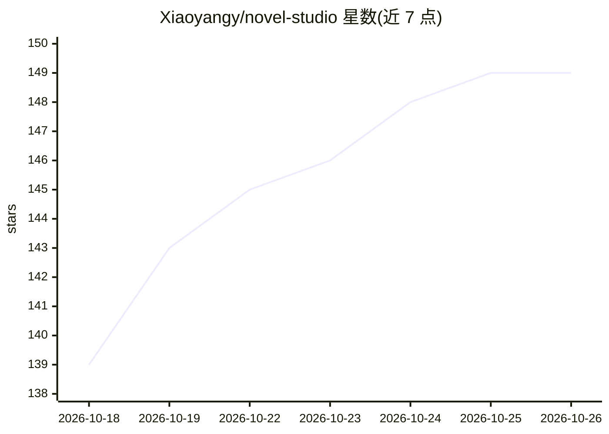

# Xiaoyangy/novel-studio

⭐ 149 · Go · Apache-2.0 · 推送 2026-09-23 · [GitHub](https://github.com/Xiaoyangy/novel-studio) · 个人维护 · 中文 README

**本地优先的 AI 长篇小说创作引擎：多智能体推演与逐章审核**

面向长篇小说、网文连载与短篇整书创作的 CLI 工具：先由 Architect 冻结全书章纲与世界设定，当前弧内让重要角色作为独立 Agent 决策，World Arbiter 裁决后果，随后逐章渲染并经 Editor/Reviewer 多重审核，通过后进入正史。支持按角色路由模型（覆盖 OpenAI/Anthropic/DeepSeek/Ollama 等 14 类适配器）、RAG 长程记忆（BM25/embedding/Qdrant 可选）、checkpoint 断点恢复、成本预算与只读 Dashboard。项目数据全部保存在本机，正文是否发送远程取决于所选 provider。

## 筛选速览

| 维度 | 判定 | 备注 |
|---|---|---|
| AI 角色 | `ai-native` | 本体是模型或模型工具 |
| 许可风险 | `permissive` | Apache-2.0 |
| 部署形态 | `self-host` | docker 或自建部署 |
| 模型依赖 | local-ok | 支持本地模型 |
| 硬件要求 | — | 无带数字的原话,不猜 |
| 安装摩擦 | `low` | 无编译、无系统依赖或容器化 |
| 成熟度 | — | 结构信号不足 |

## 能力要点

- 多角色 Agent 决策 + World Arbiter 裁决的按弧推演机制
- 逐章渲染、多重审核、SHA-256 绑定的原子发布
- checkpoint、租约与幂等恢复的断点续写
- 14 类模型 provider 适配与按角色路由/预算控制

## 适用场景

- 长期连载中维护人物、关系、伏笔与知识边界的一致性
- 从 prompt 或创作合同文件启动并逐章推进整本书
- 开发者自选模型、RAG 与成本预算控制生产过程

## 场景标签

`AI 写作` `多智能体` `RAG` · 领域:Agent 开发

## 证据(README 行号)

> L5: **开源、本地优先、可恢复的 AI 长篇小说创作引擎。**
> L20: novel-studio 面向长篇小说、网文连载、短篇整书和故事工作室。它把大纲、人物、世界状态、RAG、正文审核与返工从易丢失的聊天上下文，转换成保存在本机、可验证、可恢复的生产流水线。
> L271: novel-studio 支持按角色选择 provider、model、reasoning effort 和 fallback。当前适配器覆盖 OpenAI、Anthropic、Gemini、OpenRouter、DeepSee

## 星数曲线

2026-10-18 139 → 2026-10-26 149（+10）

---
*卡片 v1 · prompt 1.4 · 生成 2026-10-22 · 置信度 high · 依据 README sha `9aa6f34993f9` · [字段定义](../../DATASET.md)*
