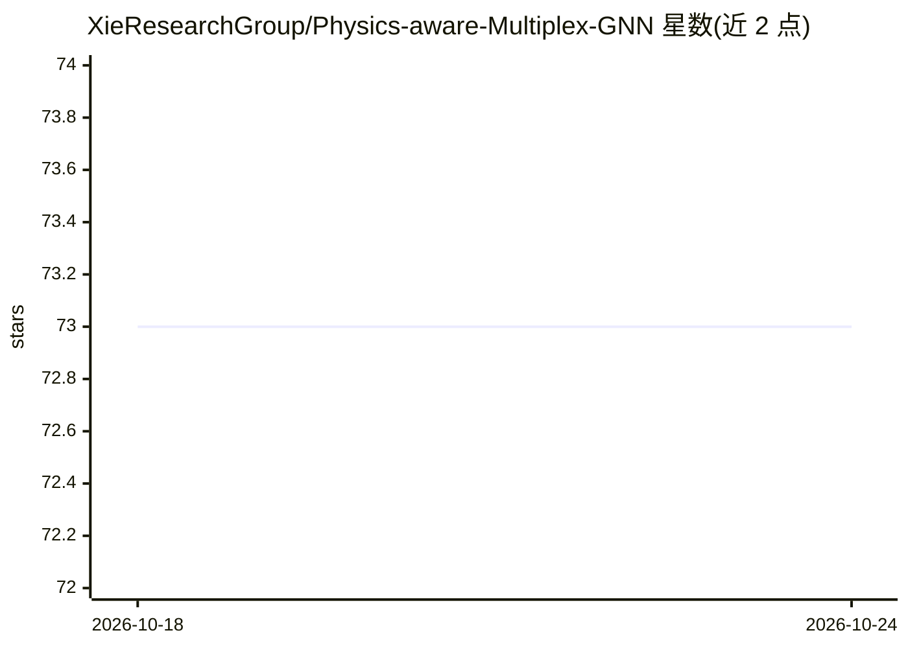

# XieResearchGroup/Physics-aware-Multiplex-GNN

⭐ 73 · Python · NOASSERTION · 推送 2026-10-08 · [GitHub](https://github.com/XieResearchGroup/Physics-aware-Multiplex-GNN) · [官网](https://www.nature.com/articles/s41598-023-46382-8) · 组织维护

**分子系统几何深度学习框架 PAMNet 的官方实现**

论文《A universal framework for accurate and efficient geometric deep learning of molecular systems》（Nature Scientific Reports）的官方代码，实现物理感知多重图神经网络 PAMNet，覆盖小分子性质预测（QM9）、RNA 3D 结构预测（RNA-Puzzles）与蛋白质-配体结合亲和力预测（PDBbind）三类任务。提供训练与推理脚本、RNA 预测的保存 checkpoint，支持 pip 依赖安装与 Docker 镜像运行，CUDA 10.1 为指定环境版本。

## 筛选速览

| 维度 | 判定 | 备注 |
|---|---|---|
| AI 角色 | `ai-native` | 本体是模型或模型工具 |
| 许可风险 | `none` | NOASSERTION |
| 部署形态 | `self-host` | docker 或自建部署 |
| 模型依赖 | — | README 未给出锁定关系 |
| 硬件要求 | — | 无带数字的原话,不猜 |
| 安装摩擦 | `low` | 无编译、无系统依赖或容器化 |
| 成熟度 | — | 结构信号不足 |

## 能力要点

- 物理感知多重图神经网络 PAMNet 官方实现
- 覆盖 QM9 / PDBbind / RNA-Puzzles 三类分子任务
- 提供 RNA 3D 结构预测的保存 checkpoint 与推理脚本
- 提供 Docker 镜像（zetayue/pamnet）

## 适用场景

- 在小分子数据集上训练和评测性质预测模型
- 复现论文中 RNA 3D 结构预测结果
- 预测蛋白质-配体结合亲和力

## 场景标签

 · 领域:计算化学/结构生物学

## 证据(README 行号)

> L4: Official implementation of **PAMNet (Physics-aware Multiplex Graph Neural Network)**, as presented in our paper **A 
> L6: PAMNet builds upon our previous MXMNet model, achieving higher accuracy and efficiency than state-of-the-art baselin

## 星数曲线

2026-10-18 73 → 2026-10-24 73（+0）

---
*卡片 v1 · prompt 1.4 · 生成 2026-10-24 · 置信度 high · 依据 README sha `af1dd6d6292d` · [字段定义](../../DATASET.md)*
