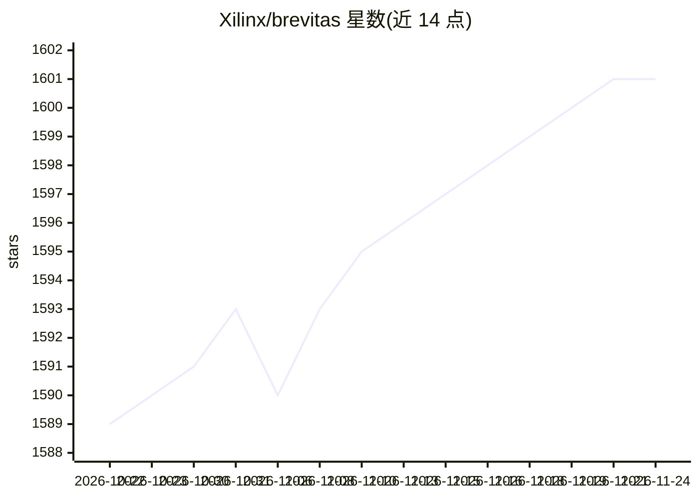

# Xilinx/brevitas

⭐ 1,601 · Python · NOASSERTION · 推送 2026-11-21 · [GitHub](https://github.com/Xilinx/brevitas) · [官网](https://xilinx.github.io/brevitas/) · 组织维护

**PyTorch 神经网络量化库：支持 PTQ 与 QAT**

面向 PyTorch 的神经网络量化库，同时支持训练后量化（PTQ）与量化感知训练（QAT）。在 brevitas.nn 下提供 QuantConv2d、QuantMultiheadAttention、QuantLSTM 等常见层的量化实现，可对输入、权重、偏置、输出等张量逐项配置量化参数（位宽、scale 粒度等），并附 ImageNet 分类模型的 PTQ 示例流程。面向需要量化模型的研究与开发人员，声明为研究项目而非 Xilinx 官方产品。

## 筛选速览

| 维度 | 判定 | 备注 |
|---|---|---|
| AI 角色 | `ai-native` | 本体是模型或模型工具 |
| 许可风险 | `none` | NOASSERTION |
| 部署形态 | `library` | 以包/库形式分发 |
| 模型依赖 | — | README 未给出锁定关系 |
| 硬件要求 | — | 无带数字的原话,不猜 |
| 安装摩擦 | `low` | 无编译、无系统依赖或容器化 |
| 成熟度 | — | 结构信号不足 |

## 能力要点

- 提供常见 PyTorch 层的量化实现（QuantConv2d、QuantRNN、QuantLSTM 等）
- 支持 PTQ 与 QAT 两种量化路径
- 量化张量可逐项配置（位宽、scale 粒度等）
- 附 ImageNet 分类 PTQ 示例流程

## 适用场景

- 把训练好的 torchvision 模型做训练后量化
- 训练中以量化感知方式得到可部署的量化模型
- 为 FPGA 等硬件部署准备低比特神经网络

## 场景标签

`模型量化` · 领域:训练与推理

## 证据(README 行号)

> L8: Brevitas is a PyTorch library for neural network quantization, with support for both *post-training quantization (PT
> L30: Brevitas currently offers quantized implementations of the most common PyTorch layers used in DNN under `brevitas.n

## 星数曲线

2026-10-22 1,589 → 2026-11-24 1,601（+12）

---
*卡片 v1 · prompt 1.4 · 生成 2026-11-23 · 置信度 high · 依据 README sha `47e3d79ad86b` · [字段定义](../../DATASET.md)*
