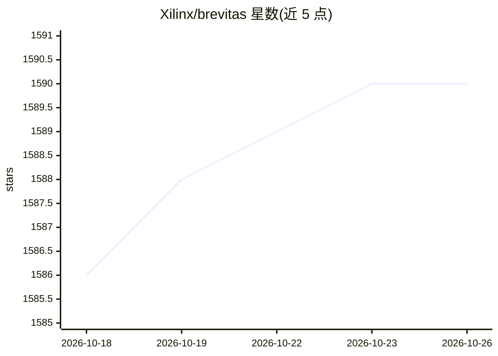

# Xilinx/brevitas

⭐ 1,590 · Python · NOASSERTION · 推送 2026-10-23 · [GitHub](https://github.com/Xilinx/brevitas) · [官网](https://xilinx.github.io/brevitas/) · 组织维护

**PyTorch 神经网络量化库，支持 PTQ 与 QAT**

Xilinx（AMD）名下的 PyTorch 量化研究库，支持训练后量化（PTQ）与量化感知训练（QAT）。在 brevitas.nn 下提供常见层的量化实现（QuantConv2d、QuantLSTM、QuantMultiheadAttention 等），输入、权重、偏置、输出等各类张量的量化可分别按位宽、缩放粒度等参数调优；并提供 ImageNet 分类模型 PTQ 示例流程。README 声明这是研究项目而非官方 Xilinx 产品。要求 Python>=3.10、PyTorch 1.13–2.13，GPU 加速为可选项。

## 筛选速览

| 维度 | 判定 | 备注 |
|---|---|---|
| AI 角色 | `ai-ecosystem` | LLM/agent 周边工具 |
| 许可风险 | `none` | NOASSERTION |
| 部署形态 | `library` | 以包/库形式分发 |
| 模型依赖 | — | README 未给出锁定关系 |
| 硬件要求 | — | 无带数字的原话,不猜 |
| 安装摩擦 | `low` | 无编译、无系统依赖或容器化 |
| 成熟度 | — | 结构信号不足 |

## 能力要点

- 支持 PTQ 与 QAT 两种量化路径
- 提供 QuantConv/QuantRNN/QuantLSTM 等常见层量化实现
- 各张量（输入/权重/偏置/输出）量化行为可逐项配置
- 附 ImageNet 分类 PTQ 参考流程（brevitas_examples）

## 适用场景

- 压缩 PyTorch 模型以部署到 FPGA 等量化友好硬件
- 通过量化感知训练在保持精度的同时降低模型位宽
- 实验不同位宽与缩放粒度配置下的 PTQ 效果

## 场景标签

`模型量化` · 领域:训练与推理

## 证据(README 行号)

> L8: Brevitas is a PyTorch library for neural network quantization, with support for both *post-training quantization (PT
> L30: Brevitas currently offers quantized implementations of the most common PyTorch layers used in DNN under `brevitas.n

## 星数曲线

2026-10-18 1,586 → 2026-10-26 1,590（+4）

---
*卡片 v1 · prompt 1.4 · 生成 2026-10-21 · 置信度 high · 依据 README sha `7d4bcf4189be` · [字段定义](../../DATASET.md)*
