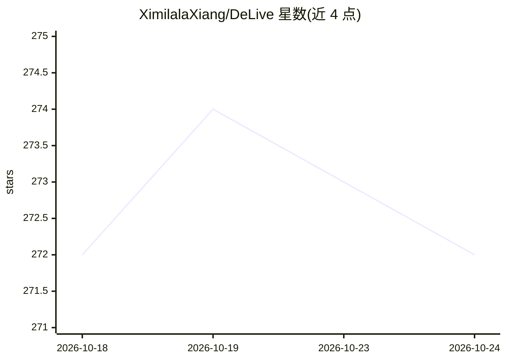

# XimilalaXiang/DeLive

⭐ 272 · TypeScript · Apache-2.0 · 推送 2026-10-22 · [GitHub](https://github.com/XimilalaXiang/DeLive) · [官网](https://delive.me) · 个人维护 · 中文 README

**桌面系统音频转录工作台：实时字幕 + 14 种 ASR 后端 + AI 审阅**

基于 Electron 的桌面应用：捕获系统音频（浏览器视频、直播、会议、课程、播客），经 14 种 ASR 后端（云：Soniox、火山引擎、Groq、Deepgram 等；本地：whisper.cpp、FunASR/SenseVoice、OpenAI 兼容服务）转为实时字幕与可搜索历史，支持上传音视频文件离线转录。内置 AI Review Desk：转写纠正、多线程聊天、结构化简报、思维导图。本地优先存储，可选 S3/WebDAV 备份，另开放本地 REST API、WebSocket 与 MCP 服务器。Windows/macOS/Linux 提供安装包。部分新功能（60db、韩语 UI 等）需 prerelease 或源码构建。

## 筛选速览

| 维度 | 判定 | 备注 |
|---|---|---|
| AI 角色 | `ai-native` | 本体是模型或模型工具 |
| 许可风险 | `permissive` | Apache-2.0 |
| 部署形态 | `desktop` | 安装包/桌面程序 |
| 模型依赖 | local-ok | 支持本地模型 |
| 硬件要求 | — | 无带数字的原话,不猜 |
| 安装摩擦 | `low` | 无编译、无系统依赖或容器化 |
| 成熟度 | — | 结构信号不足 |

## 能力要点

- 14 种 ASR 后端，含全本地 whisper.cpp 与 FunASR/SenseVoice
- 置顶悬浮字幕窗（原文/译文/双语显示）
- AI Review Desk：纠正、简报、聊天、问答、思维导图
- 本地 REST API / WebSocket / MCP 服务器，默认关闭、可配 Bearer 鉴权

## 适用场景

- 看外语视频、直播或参加线上会议时显示实时字幕
- 上传播客、课程录像做离线转写并生成摘要与思维导图
- 让外部 AI agent 通过 MCP 读取 DeLive 的转写能力

## 场景标签

`语音识别` · 领域:感知与多模态

## 证据(README 行号)

> L19: DeLive is a desktop transcription workspace for system audio. It captures whatever your computer is playing, routes
> L38: - **Fourteen ASR backends** — Soniox, Volcengine, Groq, SiliconFlow, Mistral AI, Deepgram, AssemblyAI, ElevenLabs, 

## 星数曲线

2026-10-18 272 → 2026-10-24 272（+0）

---
*卡片 v1 · prompt 1.4 · 生成 2026-10-22 · 置信度 high · 依据 README sha `9a8ac7b5321b` · [字段定义](../../DATASET.md)*
