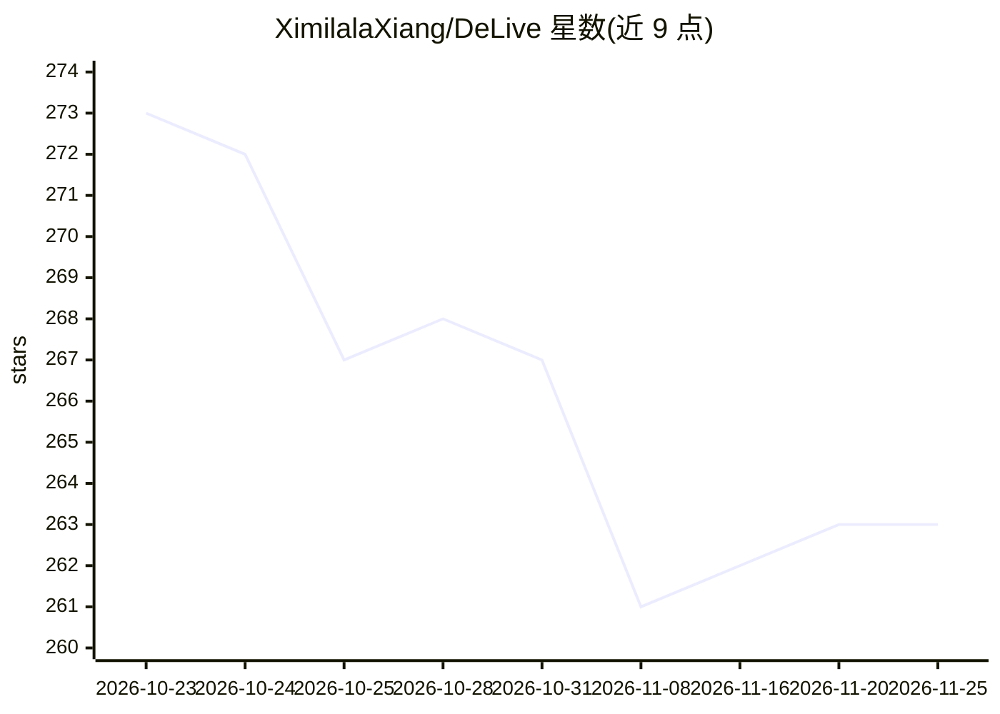

# XimilalaXiang/DeLive

⭐ 263 · TypeScript · Apache-2.0 · 推送 2026-10-22 · [GitHub](https://github.com/XimilalaXiang/DeLive) · [官网](https://delive.me) · 个人维护 · 中文 README

**系统音频实时转写与 AI 复核桌面工作区**

捕获电脑正在播放的系统音频，经 14 个 ASR 后端实时转写，本地保存为可检索历史；转写结果进入 AI 复核工作台，提供转写纠错（diff 视图）、结构化简报、多线程聊天与思维导图。支持音视频文件离线转写，含悬浮双语字幕窗口与说话人区分。Electron 桌面应用，Windows/macOS/Linux 提供安装包，数据本地存储，可选 S3/WebDAV 备份，并通过本地 REST API、WebSocket 与 MCP server 供外部 AI 工具调用。

## 筛选速览

| 维度 | 判定 | 备注 |
|---|---|---|
| AI 角色 | `ai-native` | 本体是模型或模型工具 |
| 许可风险 | `permissive` | Apache-2.0 |
| 部署形态 | `desktop` | 安装包/桌面程序 |
| 模型依赖 | local-ok | 支持本地模型 |
| 硬件要求 | — | 无带数字的原话,不猜 |
| 安装摩擦 | `low` | 无编译、无系统依赖或容器化 |
| 成熟度 | — | 结构信号不足 |

## 能力要点

- 14 个 ASR 后端，覆盖云端（Soniox/Groq/Deepgram 等）与本地（whisper.cpp、FunASR/SenseVoice）
- AI 复核工作台：纠错、结构化简报、多线程聊天、思维导图
- 本地 REST API、WebSocket 与 MCP server 供外部 AI agent 接入
- 悬浮置顶字幕窗口，支持原文/译文/双语显示

## 适用场景

- 为会议、网课、直播、播客生成实时字幕与转写记录
- 对录制的音视频文件批量转写并做 AI 总结
- 让外部 AI agent 通过 MCP 读取转写数据

## 场景标签

`语音识别` · 领域:感知与多模态

## 证据(README 行号)

> L19: DeLive is a desktop transcription workspace for system audio. It captures whatever your computer is playing, routes
> L53: - **Fourteen ASR backends** — Soniox, Volcengine, Groq, SiliconFlow, Mistral AI, Deepgram, AssemblyAI, ElevenLabs, 
> L60: - **Open API & MCP** — local REST API, real-time WebSocket, MCP server for AI agents

## 星数曲线

2026-10-23 273 → 2026-11-25 263（-10）

---
*卡片 v1 · prompt 1.4 · 生成 2026-11-25 · 置信度 high · 依据 README sha `39c7d8bab427` · [字段定义](../../DATASET.md)*
