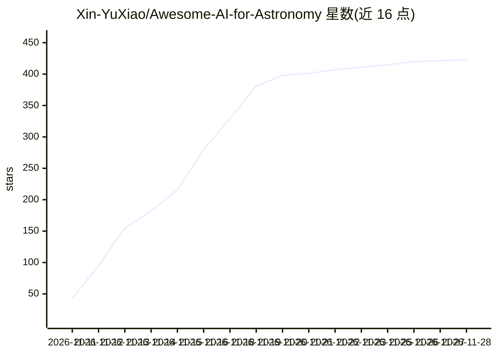

# Xin-YuXiao/Awesome-AI-for-Astronomy

⭐ 423 · Python · NOASSERTION · 推送 2026-11-27 · [GitHub](https://github.com/Xin-YuXiao/Awesome-AI-for-Astronomy) · [官网](https://xin-yuxiao.github.io/Awesome-AI-for-Astronomy/) · 组织维护

**天体物理 AI 研究论文策展清单，附可检索网页**

收录天文学、天体物理、宇宙学、太阳物理与行星科学领域机器学习相关论文、模型、数据集、基准与软件的策展清单，共 497 篇论文与 68 个软件包，按综述、基础模型、语言模型、Agent、基准等分节组织，每条条目附 arXiv 标识、DOI、代码与模型权重链接，收录前逐一核对。提供可按分节、年份、发表载体、公开代码等条件过滤的网页版，支持导出 JSON/CSV；另有每日抓取 arXiv 新论文并由语言模型生成摘要的 AstroAI Today 栏目。

## 筛选速览

| 维度 | 判定 | 备注 |
|---|---|---|
| AI 角色 | `ai-knowledge` | 知识聚合/清单类 |
| 许可风险 | `none` | NOASSERTION |
| 部署形态 | `library` | 以包/库形式分发 |
| 模型依赖 | — | README 未给出锁定关系 |
| 硬件要求 | — | 无带数字的原话,不猜 |
| 安装摩擦 | `low` | 无编译、无系统依赖或容器化 |
| 成熟度 | — | 结构信号不足 |

## 能力要点

- 497 篇论文按子领域分节组织，每条附代码/模型链接
- 网页版可按分节、年份、载体、公开代码与数据模态过滤，支持 JSON/CSV 导出
- AstroAI Today 每日抓取 arXiv 新论文并生成 TL;DR
- 提供可在兼容 AI 工具中查询目录的 Research skill

## 适用场景

- 查找天文学某个子领域的机器学习论文与公开代码
- 追踪天文领域基础模型与 LLM 的最新进展
- 为综述或选题调研导出结构化论文清单

## 场景标签

`精选清单` `科研工具` · 领域:学习与行业

## 证据(README 行号)

> L3: **A curated list of papers, models, datasets, benchmarks and software for artificial intelligence in astronomy, astr
> L22: This list tracks machine learning work in astronomy with public papers, linking public code where it exists. It emp

## 星数曲线

2026-11-11 43 → 2026-11-28 423（+380）

---
*卡片 v1 · prompt 1.4 · 生成 2026-11-28 · 置信度 mid · 依据 README sha `fdf16d76ddc6` · [字段定义](../../DATASET.md)*
