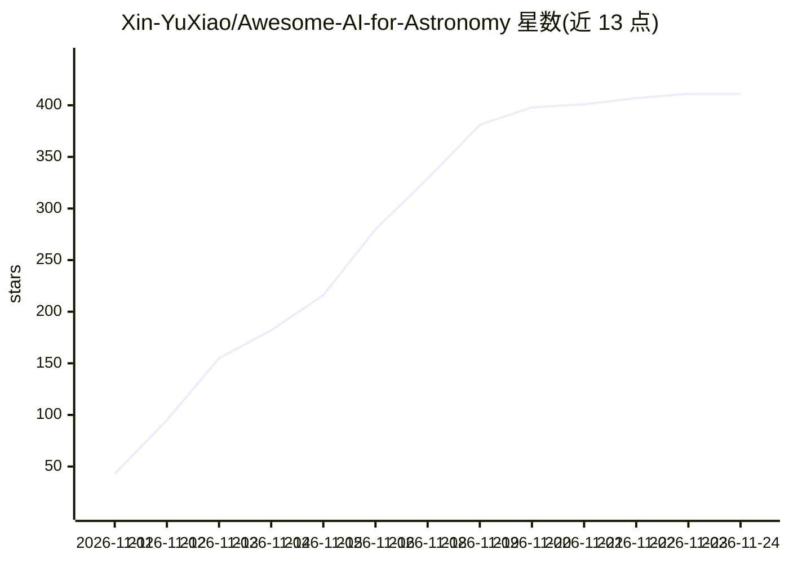

# Xin-YuXiao/Awesome-AI-for-Astronomy

⭐ 411 · Python · NOASSERTION · 推送 2026-11-21 · [GitHub](https://github.com/Xin-YuXiao/Awesome-AI-for-Astronomy) · [官网](https://xin-yuxiao.github.io/Awesome-AI-for-Astronomy/) · 个人维护

**天文与天体物理 AI 论文/模型/基准策展清单**

收录天文学、天体物理、宇宙学、日球物理与行星科学领域机器学习研究的策展清单：覆盖综述、基础模型（图像/光谱/时序/多模态）、天文语言模型、Agent 与检索系统、基准等类别，共 429 篇论文与 66 个软件包，条目标注日期、发表渠道、代码/模型/数据可得性。提供可按年份、渠道、代码可得性等维度过滤的可检索网页，支持 JSON/CSV 下载。另有 AstroAI Today 每日收集 arXiv 新论文并用语言模型生成 TL;DR（未评审），主清单经人工收录核验。

## 筛选速览

| 维度 | 判定 | 备注 |
|---|---|---|
| AI 角色 | `ai-knowledge` | 知识聚合/清单类 |
| 许可风险 | `none` | NOASSERTION |
| 部署形态 | `library` | 以包/库形式分发 |
| 模型依赖 | — | README 未给出锁定关系 |
| 硬件要求 | — | 无带数字的原话,不猜 |
| 安装摩擦 | `low` | 无编译、无系统依赖或容器化 |
| 成熟度 | — | 结构信号不足 |

## 能力要点

- 429 篇论文与 66 个软件包，按基础模型/语言模型/Agent/基准等类别组织
- 可检索网页支持按年份、渠道、代码、模型权重、数据模态过滤
- 条目经 arXiv 标识符、DOI 与仓库链接核验，附一句话摘要
- AstroAI Today 每日收集新论文并由语言模型生成 TL;DR

## 适用场景

- 查找天文领域的基础模型与语言模型论文及代码
- 追踪天文 AI 基准与评测数据集
- 了解 2021 年以来天文领域 AI 研究脉络

## 场景标签

`精选清单` `科研工具` · 领域:学习与行业

## 证据(README 行号)

> L3: **A curated list of papers, models, datasets, benchmarks and software for artificial intelligence in astronomy, astr
> L14: > The searchable web page filters all 429 papers and 66 software packages by section, year, venue type, public code

## 星数曲线

2026-11-11 43 → 2026-11-24 411（+368）

---
*卡片 v1 · prompt 1.4 · 生成 2026-11-17 · 置信度 mid · 依据 README sha `503284414e47` · [字段定义](../../DATASET.md)*
