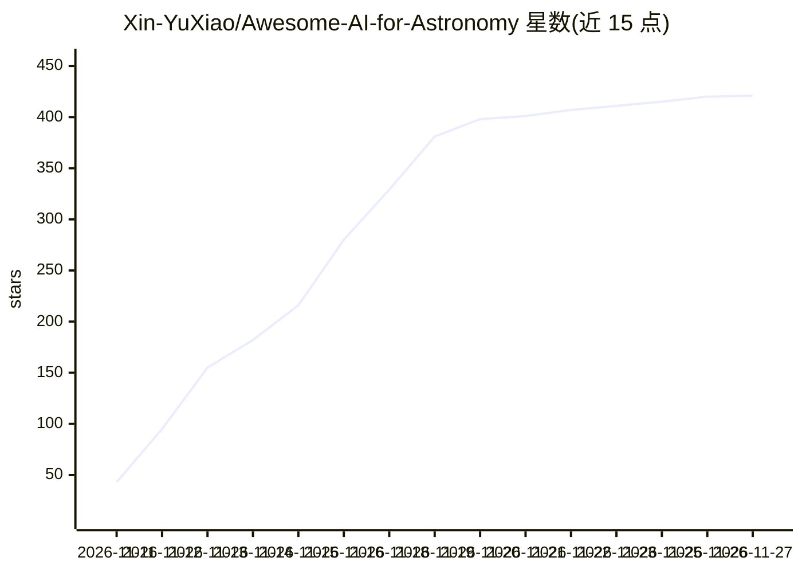

# Xin-YuXiao/Awesome-AI-for-Astronomy

⭐ 421 · Python · NOASSERTION · 推送 2026-11-26 · [GitHub](https://github.com/Xin-YuXiao/Awesome-AI-for-Astronomy) · [官网](https://xin-yuxiao.github.io/Awesome-AI-for-Astronomy/) · 个人维护

**天文学与天体物理 AI 论文/模型/数据集编目清单**

按条目组织的论文清单，收录天文学、天体物理学、宇宙学、太阳物理与行星科学领域的机器学习工作，共 494 篇论文与 67 个软件包，按综述、基础模型、语言模型、Agent 与基准等章节分类。条目附 arXiv 标识、DOI、代码链接与发表信息，收录前对链接逐一核对。配套可检索网页支持按章节、年份、载体、公开代码/权重/数据与数据模态过滤，并可导出 JSON/CSV；AstroAI Today 栏目每日用语言模型（DeepSeek）筛选新 arXiv 论文并生成摘要，该部分未经人工评审。

## 筛选速览

| 维度 | 判定 | 备注 |
|---|---|---|
| AI 角色 | `ai-knowledge` | 知识聚合/清单类 |
| 许可风险 | `none` | NOASSERTION |
| 部署形态 | `library` | 以包/库形式分发 |
| 模型依赖 | — | README 未给出锁定关系 |
| 硬件要求 | — | 无带数字的原话,不猜 |
| 安装摩擦 | `low` | 无编译、无系统依赖或容器化 |
| 成熟度 | — | 结构信号不足 |

## 能力要点

- 收录 494 篇论文与 67 个软件包，按 2021 年后基础模型/语言模型/Agent 等章节组织
- 每个 arXiv 标识、DOI 与仓库链接收录前逐一核对
- 可检索网页支持按模态、年份、公开代码/权重过滤，可导出 JSON/CSV
- AstroAI Today 每日用语言模型筛选新 arXiv 论文并生成 TL;DR（未经评审）

## 适用场景

- 查找天文学各子领域的机器学习论文与公开代码
- 跟踪天文领域基础模型与语言模型的最新进展
- 按数据模态或发表年份筛选天文 AI 相关研究

## 场景标签

`精选清单` `科研工具` · 领域:学习与行业

## 证据(README 行号)

> L3: **A curated list of papers, models, datasets, benchmarks and software for artificial intelligence in astronomy, astr
> L14: > The searchable web page filters all 494 papers and 67 software packages by section, year, venue type, public code

## 星数曲线

2026-11-11 43 → 2026-11-27 421（+378）

---
*卡片 v1 · prompt 1.4 · 生成 2026-11-27 · 置信度 mid · 依据 README sha `d88e9df73c60` · [字段定义](../../DATASET.md)*
