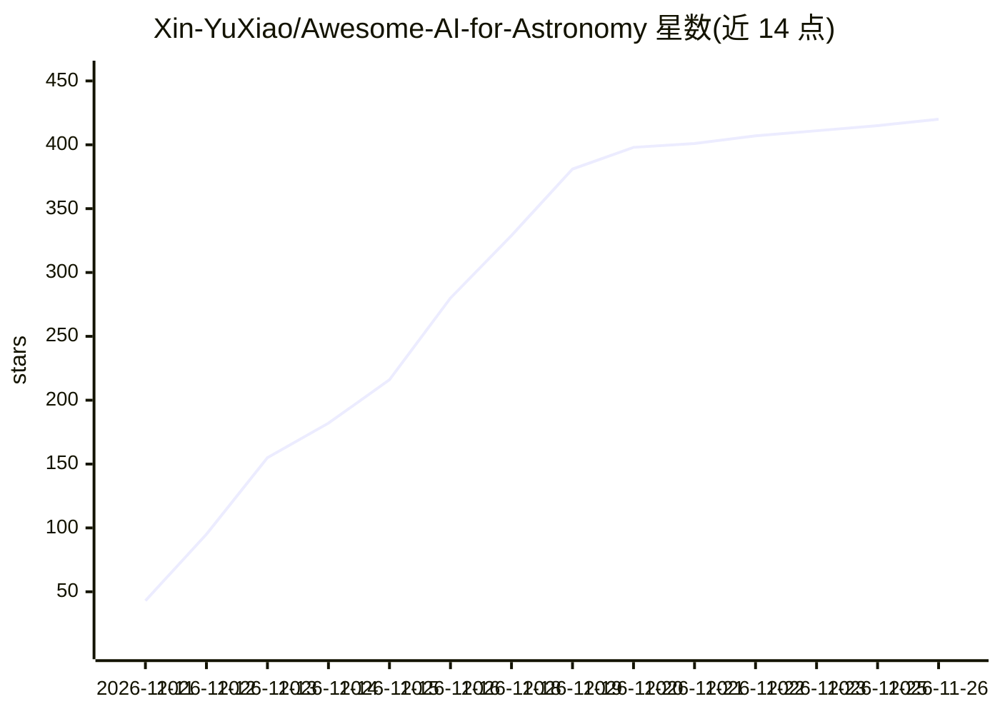

# Xin-YuXiao/Awesome-AI-for-Astronomy

⭐ 420 · Python · NOASSERTION · 推送 2026-11-25 · [GitHub](https://github.com/Xin-YuXiao/Awesome-AI-for-Astronomy) · [官网](https://xin-yuxiao.github.io/Awesome-AI-for-Astronomy/) · 个人维护

**天体物理领域 AI 论文/模型/数据集策展清单（482 篇）**

收录天文学、天体物理、宇宙学、空间物理与行星科学中机器学习工作的论文清单，覆盖综述、基础模型、语言与视觉语言模型、agent 与检索系统、基准等章节，每条附日期、发表载体与公开代码链接，按子领域最新在前排列，收录前核验 arXiv 编号、DOI 与仓库链接。配套可搜索网页按章节/年份/载体/公开代码等过滤全部 482 篇论文与 66 个软件包，并提供 JSON/CSV 下载；AstroAI Today 每日用语言模型筛选新 arXiv 论文并写一句话摘要（未经人工评审）。

## 筛选速览

| 维度 | 判定 | 备注 |
|---|---|---|
| AI 角色 | `ai-knowledge` | 知识聚合/清单类 |
| 许可风险 | `none` | NOASSERTION |
| 部署形态 | `library` | 以包/库形式分发 |
| 模型依赖 | — | README 未给出锁定关系 |
| 硬件要求 | — | 无带数字的原话,不猜 |
| 安装摩擦 | `low` | 无编译、无系统依赖或容器化 |
| 成熟度 | — | 结构信号不足 |

## 能力要点

- 收录 482 篇论文与 66 个软件包，附公开代码链接
- 覆盖综述、基础模型、LLM、agent、基准等章节，含图像/光谱/时序/多模态子类
- 收录前逐条核验 arXiv 编号、DOI 与仓库链接
- 配套可过滤搜索网页及 JSON/CSV 导出

## 适用场景

- 查找天文学各子领域的深度学习与基础模型论文
- 调研天文领域专用语言模型与 agent 系统
- 为科研选题追踪最新的 AI4Astronomy 进展

## 场景标签

`精选清单` `科研工具` · 领域:学习与行业

## 证据(README 行号)

> L3: **A curated list of papers, models, datasets, benchmarks and software for artificial intelligence in astronomy, astr
> L14: > The searchable web page filters all 482 papers and 66 software packages by section, year, venue type, public code
> L22: This list tracks machine learning work in astronomy with public papers, linking public code where it exists. It emp

## 星数曲线

2026-11-11 43 → 2026-11-26 420（+377）

---
*卡片 v1 · prompt 1.4 · 生成 2026-11-26 · 置信度 mid · 依据 README sha `3976139c8e81` · [字段定义](../../DATASET.md)*
