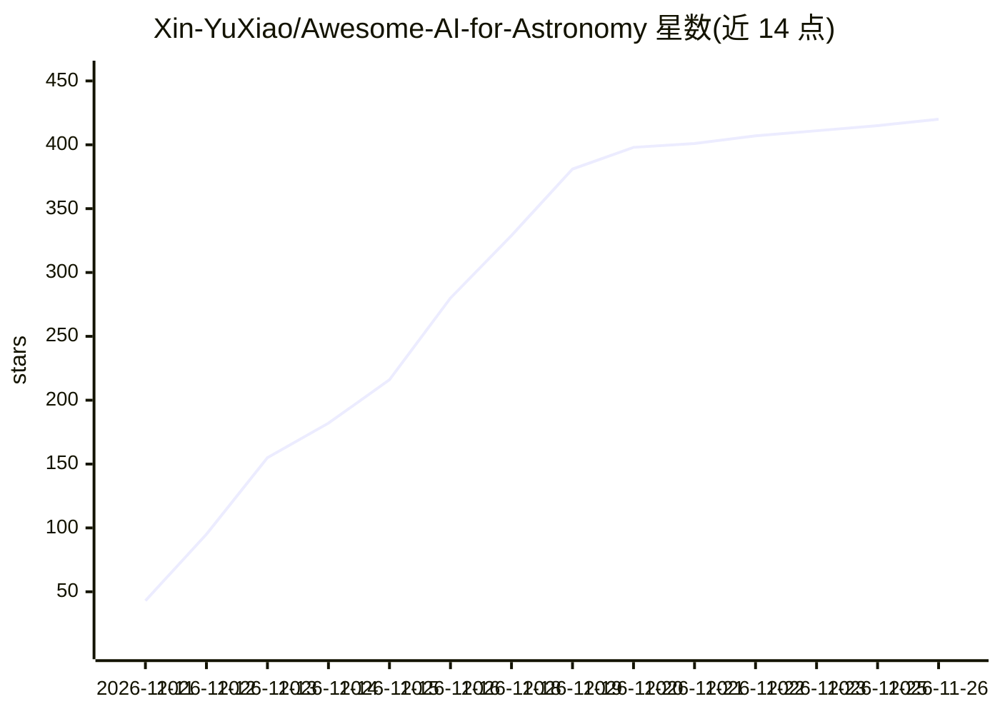

# Xin-YuXiao/Awesome-AI-for-Astronomy

⭐ 420 · Python · NOASSERTION · 推送 2026-11-25 · [GitHub](https://github.com/Xin-YuXiao/Awesome-AI-for-Astronomy) · [官网](https://xin-yuxiao.github.io/Awesome-AI-for-Astronomy/) · 组织维护

**天体物理等领域 AI 研究的论文清单（468 篇）**

收录天文学、天体物理、宇宙学、太阳物理与行星科学中机器学习相关论文、模型、数据集、基准与软件的可检索清单，共 468 篇论文与 66 个软件包。条目按综述、基础模型、语言模型、Agent、基准等章节组织，收录前核对 arXiv 标识、DOI 与代码仓库链接。配套网页可按章节、年份、发表载体、公开代码/权重/数据、数据模态过滤，并导出 JSON/CSV；另有每日 arXiv 论文筛选栏目与可查询该目录的 AI 技能。

## 筛选速览

| 维度 | 判定 | 备注 |
|---|---|---|
| AI 角色 | `ai-knowledge` | 知识聚合/清单类 |
| 许可风险 | `none` | NOASSERTION |
| 部署形态 | `library` | 以包/库形式分发 |
| 模型依赖 | — | README 未给出锁定关系 |
| 硬件要求 | — | 无带数字的原话,不猜 |
| 安装摩擦 | `low` | 无编译、无系统依赖或容器化 |
| 成熟度 | — | 结构信号不足 |

## 能力要点

- 468 篇论文与 66 个软件包的链接核验清单
- 网页按章节/年份/载体/代码/权重/数据模态过滤，支持 JSON/CSV 导出
- 每日 arXiv 机器学习-天文论文筛选（语言模型生成 TL;DR）
- 提供可查询目录的 AstroAI Research skill

## 适用场景

- 查找天文各子领域的基础模型与深度学习论文
- 检索带公开代码或模型权重的天文 ML 工作
- 跟进天文领域 LLM 与 Agent 研究进展

## 场景标签

`精选清单` `模型评测` · 领域:评测与运维

## 证据(README 行号)

> L3: **A curated list of papers, models, datasets, benchmarks and software for artificial intelligence in astronomy, astr
> L14: > The searchable web page filters all 468 papers and 66 software packages by section, year, venue type, public code

## 星数曲线

2026-11-11 43 → 2026-11-26 420（+377）

---
*卡片 v1 · prompt 1.4 · 生成 2026-11-25 · 置信度 mid · 依据 README sha `4c561052d002` · [字段定义](../../DATASET.md)*
