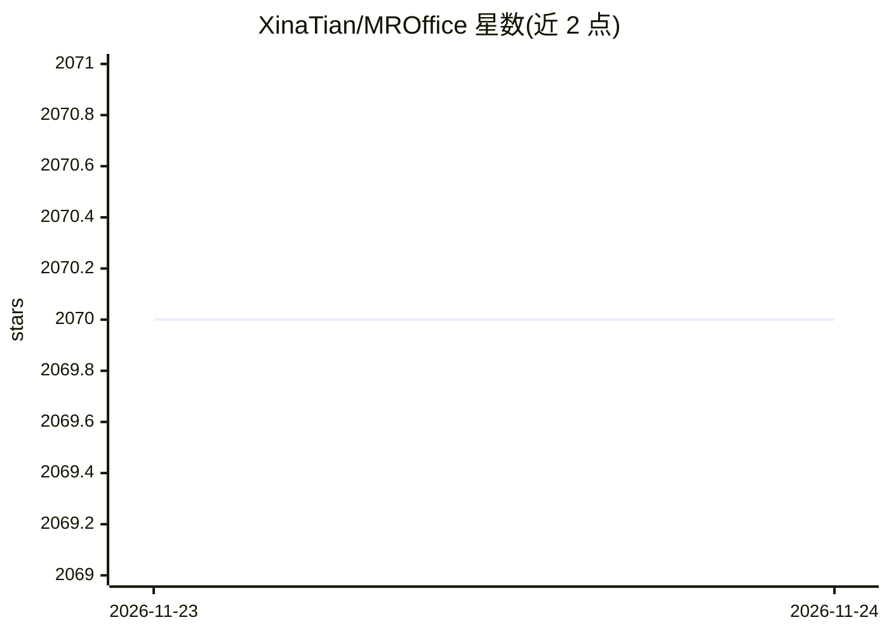

# XinaTian/MROffice

⭐ 2,070 · TypeScript · AGPL-3.0 · 推送 2026-11-22 · [GitHub](https://github.com/XinaTian/MROffice) · [官网](https://mroffice.ai) · 组织维护

**浏览器内的开源办公编辑器套件，可一行嵌入应用并经 MCP 供 AI 应用调用**

本仓库发布 MR Office 的六个编辑器源码：文档、表格、演示、PDF、手写与代码，均在浏览器中运行。开发者可通过托管嵌入服务（签名会话令牌）在网页中编辑真实文件，或经 MCP 服务器让 AI 应用打开、读取、编辑与导出文档，也可作 React 组件经 npm 安装或自托管构建。限制：开源编辑器不包含 Word/Excel/PowerPoint 文件的读写，公式函数计算、图表与 SmartArt 需 MR Office 桌面应用；嵌入托管为商业服务，有免费额度。

## 筛选速览

| 维度 | 判定 | 备注 |
|---|---|---|
| AI 角色 | `ai-enhanced` | 去掉 AI 部分产品仍成立 |
| 许可风险 | `dual` | AGPL-3.0 |
| 部署形态 | `library` | 以包/库形式分发 |
| 模型依赖 | — | README 未给出锁定关系 |
| 硬件要求 | — | 无带数字的原话,不猜 |
| 安装摩擦 | `low` | 无编译、无系统依赖或容器化 |
| 成熟度 | — | 结构信号不足 |

## 能力要点

- 六个编辑器：文档、表格、演示、PDF、手写、代码，浏览器内运行
- 托管嵌入：服务端签名会话令牌，编辑回传经签名回调
- MCP 服务器（托管端点或 npx 本地运行）供 AI 应用操作文档
- 编辑器以 React 组件发布于 npm，支持自托管构建与 Electron 桌面壳

## 适用场景

- 在网页应用中嵌入文档/表格/演示编辑器并支持协同编辑
- 让 Claude 等 AI 应用通过 MCP 打开并编辑真实文档文件
- 自托管开源编辑器处理自有格式、CSV、Markdown 与 PDF
- 在 Electron 桌面壳中运行编辑器并配合离线使用

## 场景标签

 · 领域:办公/文档工具

## 证据(README 行号)

> L5:  The open-source editors of MR Office, the editor closest to Microsoft Office — documents, spreadsheets, presentatio
> L49: AI apps open, read, edit and export documents in the real MR Office editor through its MCP server: connect the host
> L57: The six editors in this repository can be built into your own product under the AGPL-3.0: if people use a modified 

## 星数曲线

2026-11-23 2,070 → 2026-11-24 2,070（+0）

---
*卡片 v1 · prompt 1.4 · 生成 2026-11-23 · 置信度 high · 依据 README sha `05d87789ce8a` · [字段定义](../../DATASET.md)*
