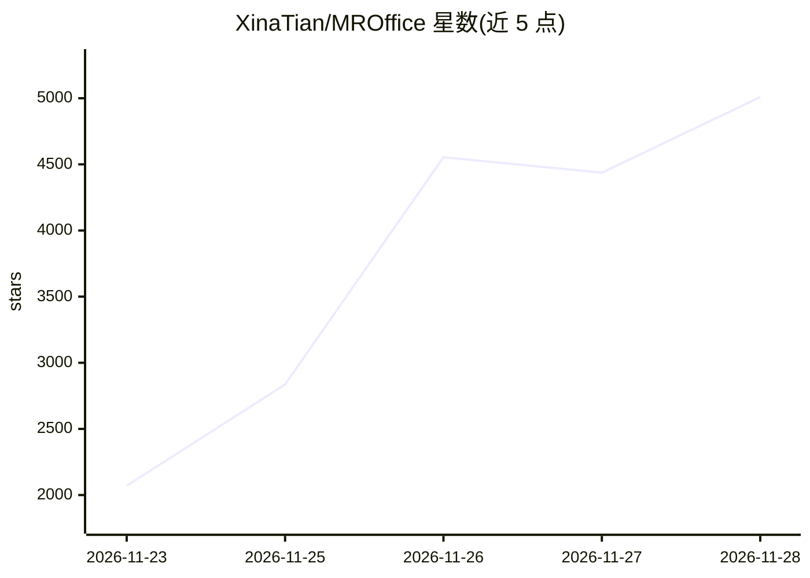

# XinaTian/MROffice

⭐ 5,009 · TypeScript · AGPL-3.0 · 推送 2026-11-26 · [GitHub](https://github.com/XinaTian/MROffice) · [官网](https://mroffice.ai) · 组织维护

**开源浏览器端 Office 套件编辑器，AI 与 MCP 客户端直接编辑 Office 文件**

MR Office 开源其五款浏览器端编辑器（文档、表格、演示、PDF、代码），可自行构建、运行或以 React 组件/npm 包嵌入。Copilot 嵌在每个编辑器中，AI 在文件对象上就地修改并需用户确认变更；MCP server 让 Claude、ChatGPT、Cursor、Codex 等 MCP 客户端创建、编辑、导出真实 docx/xlsx/pptx 文件。编辑器本体为 AGPL-3.0，完整 Word/Excel/PowerPoint 格式支持依赖官方桌面组件或托管 embed；提供免费额度与付费商业许可。

## 筛选速览

| 维度 | 判定 | 备注 |
|---|---|---|
| AI 角色 | `ai-enhanced` | 去掉 AI 部分产品仍成立 |
| 许可风险 | `dual` | AGPL-3.0 |
| 部署形态 | `library` | 以包/库形式分发 |
| 模型依赖 | — | README 未给出锁定关系 |
| 硬件要求 | — | 无带数字的原话,不猜 |
| 安装摩擦 | `low` | 无编译、无系统依赖或容器化 |
| 成熟度 | — | 结构信号不足 |

## 能力要点

- 五款浏览器端编辑器：文档、表格、演示、PDF、代码
- MCP server 让 MCP 客户端创建/读取/编辑/导出真实 Office 文件
- AI 修改需用户确认，文件变更后提议作废
- 可 npm 安装或作为 React 组件嵌入自有应用

## 适用场景

- 在自建应用中嵌入文档/表格/演示编辑器
- 让 Claude 或 Codex 等 agent 直接编辑 Office 文件
- 浏览器内完成 Word/Excel/PPT 与 PDF 的查看编辑

## 场景标签

 · 领域:办公软件/生产力工具

## 证据(README 行号)

> L5:  The open-source editors of MR Office, the AI office suite closest to Microsoft Office: documents, spreadsheets, pre
> L95: The five editors in this repository can be built into your own product under the AGPL-3.0: if people use a modified
> L103: - **Documents** — a paged word processor: fonts, paragraph formatting, lists and styles on Home; cover and blank p

## 星数曲线

2026-11-23 2,070 → 2026-11-28 5,009（+2,939）

---
*卡片 v1 · prompt 1.4 · 生成 2026-11-24 · 置信度 high · 依据 README sha `ae0616b2fbdc` · [字段定义](../../DATASET.md)*
