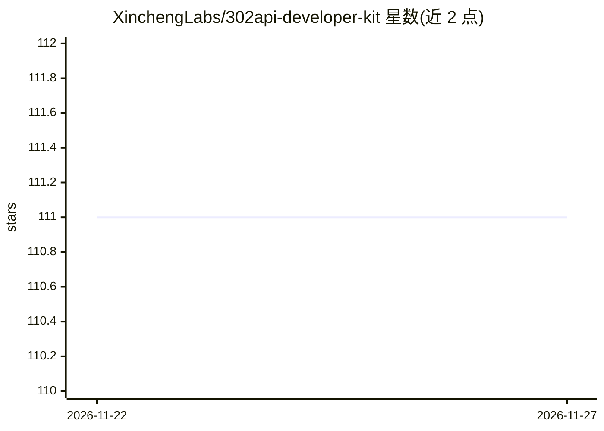

# XinchengLabs/302api-developer-kit

⭐ 111 · Python · Apache-2.0 · 推送 2026-11-24 · [GitHub](https://github.com/XinchengLabs/302api-developer-kit) · [官网](https://302api.com) · 组织维护 · 中文 README

**302API 接入工具包：示例、客户端配置与账单验算器**

面向使用 302API 服务的开发者：一个 Key 调用 Claude、GPT、Gemini 模型。仓库提供 Python 标准库实现的接入自检脚本 doctor.py（检查 Key、地址、鉴权并列出可用模型），Python/Node.js/cURL 三种语言的十余个可运行示例（对话、流式、工具调用、视觉、缓存），Claude Code、Codex CLI、Cline、Cherry Studio、DSH 的客户端配置，以及可逐笔核对扣费的离线账单验算器（含 69 项单元测试、带日期的价格快照）。Apache-2.0 许可，再分发须保留 NOTICE 署名；不包含服务端计费实现。

## 筛选速览

| 维度 | 判定 | 备注 |
|---|---|---|
| AI 角色 | `ai-ecosystem` | LLM/agent 周边工具 |
| 许可风险 | `permissive` | Apache-2.0 |
| 部署形态 | `library` | 以包/库形式分发 |
| 模型依赖 | locked-api |  |
| 硬件要求 | — | 无带数字的原话,不猜 |
| 安装摩擦 | `low` | 无编译、无系统依赖或容器化 |
| 成熟度 | — | 结构信号不足 |

## 能力要点

- 零依赖自检脚本 doctor.py，输出 SDK 与 CLI 可复制的配置
- Python / Node.js / cURL 示例覆盖对话、流式、工具调用、视觉与提示缓存
- 纯标准库离线账单验算器，覆盖缓存读写、长上下文倍率与分时价格
- 网关为 OpenAI 格式调用 Claude 自动加缓存标记

## 适用场景

- 接入 302API 前一键自检 Key 与网络配置
- 参考可运行示例学习 OpenAI 兼容与 Anthropic 原生协议
- 用离线验算器逐笔核对 API 账单扣费
- 为自己的站点复用前端组件与客户端配置

## 场景标签

 · 领域:LLM 基础设施/API 接入

## 证据(README 行号)

> L8: **一个 Key 调用 Claude、GPT、Gemini 官方模型的开源接入工具包。** 一条命令自检接入，十余个可直接运行的示例，主流 AI 编程工具的现成配置，以及能逐笔核对账单的本地验算器。
> L17: |**两种原生协议**|OpenAI 兼容（`/v1/chat/completions`、`/v1/responses`）与 Anthropic 原生（`/v1/messages`）同时支持，现有 SDK 改地址和 Key 即可|

## 星数曲线

2026-11-22 111 → 2026-11-27 111（+0）

---
*卡片 v1 · prompt 1.4 · 生成 2026-11-22 · 置信度 mid · 依据 README sha `468a1e35cbb9` · [字段定义](../../DATASET.md)*
