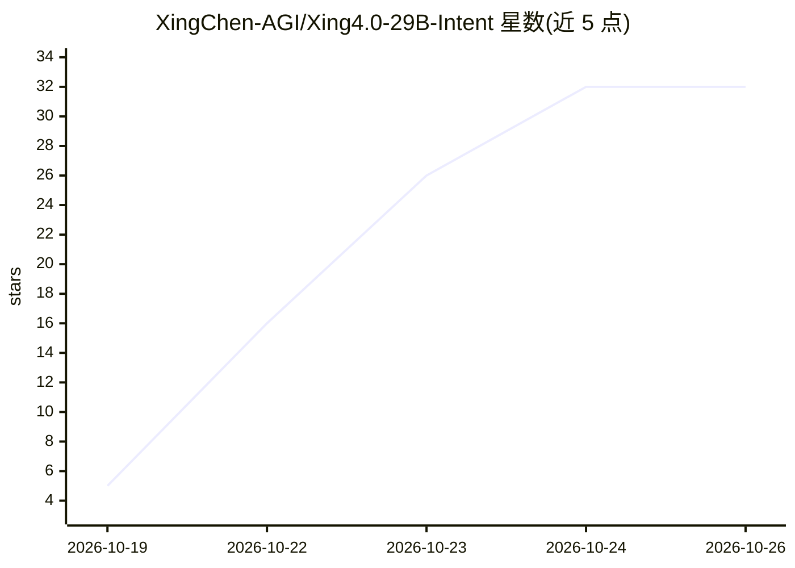

# XingChen-AGI/Xing4.0-29B-Intent

⭐ 32 · Python · Apache-2.0 · 推送 2026-10-19 · [GitHub](https://github.com/XingChen-AGI/Xing4.0-29B-Intent) · 组织维护 · 中文 README

**中国电信的 schema 引导意图识别与结构化信息抽取 MoE 模型**

Xing4.0-29B-Intent 是中国电信人工智能科技公司基于 Xing4.0-29B-A4B（29B 总参数、约 4B 激活参数的 MoE）训练的模型，将自然语言转为结构化 JSON（category + args），支持意图识别与槽位填充、命名实体识别、关系抽取、事件抽取四类任务，输入由候选类别、类别描述与字段定义构成的 schema。配套 SDK 负责提示组装与结果解析，可经 OpenAI 兼容 API 调用 vLLM/SGLang 部署的服务；另有含约 275 万样本的开源配套数据集。模型权重、数据与代码以 Apache-2.0 发布。

## 筛选速览

| 维度 | 判定 | 备注 |
|---|---|---|
| AI 角色 | `ai-native` | 本体是模型或模型工具 |
| 许可风险 | `permissive` | Apache-2.0 |
| 部署形态 | `library` | 以包/库形式分发 |
| 模型依赖 | local-ok | 支持本地模型 |
| 硬件要求 | — | 无带数字的原话,不猜 |
| 安装摩擦 | `low` | 无编译、无系统依赖或容器化 |
| 成熟度 | — | 结构信号不足 |

## 能力要点

- 四类抽取任务统一为 category + args 表示，输出 JSON 数组
- schema 引导任务配置：候选类别、类别描述与字段定义
- 配套 SDK 提供 schema 定义、提示组装、多轮对话与同步/异步调用
- 配套开源数据集约 275 万样本，覆盖 4 类任务、19 领域、52 语言

## 适用场景

- 智能助手中把用户请求解析为意图与业务参数
- 对话系统或工单系统的请求路由与分类
- 文档中实体、关系与事件的结构化抽取

## 场景标签

 · 领域:NLP/语义理解

## 证据(README 行号)

> L16: **Xing4.0-29B-Intent** is a **schema-guided model for intent recognition and structured information extraction**, d
> L36: |Supported tasks|Intent recognition and slot filling, named entity recognition, relation extraction, event extracti
> L38: |Output|A JSON array whose items contain `category` and `args`|

## 星数曲线

2026-10-19 5 → 2026-10-26 32（+27）

---
*卡片 v1 · prompt 1.4 · 生成 2026-10-26 · 置信度 high · 依据 README sha `7adf2578f822` · [字段定义](../../DATASET.md)*
