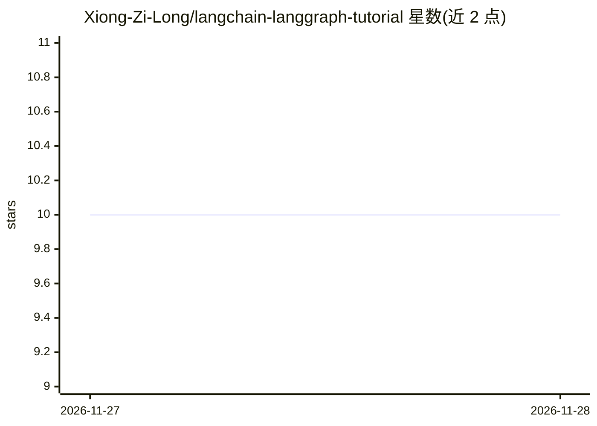

# Xiong-Zi-Long/langchain-langgraph-tutorial

⭐ 10 · Python · MIT · 推送 2026-09-18 · [GitHub](https://github.com/Xiong-Zi-Long/langchain-langgraph-tutorial) · 个人维护 · 中文 README

**面向自学者的中文 LangChain/LangGraph 教程与企业级项目**

一套中文开源教程，共 10 章：从 LangChain 基础、RAG、LangGraph 到企业级项目（混合检索 RAG + ReAct Agent + 人工审批 + FastAPI + Vue 3 + PostgreSQL/pgvector），并附面试题集、练习题与背诵手册。目标读者为会写 Python 脚本但缺少工程经验的学习者。脚本在 Python 3.14 + Windows 环境验证通过，需要 OpenAI 兼容 LLM 密钥、embedding 密钥，第 4 章需 Docker 运行数据库。

## 筛选速览

| 维度 | 判定 | 备注 |
|---|---|---|
| AI 角色 | `ai-knowledge` | 知识聚合/清单类 |
| 许可风险 | `permissive` | MIT |
| 部署形态 | `self-host` | docker 或自建部署 |
| 模型依赖 | — | README 未给出锁定关系 |
| 硬件要求 | — | 无带数字的原话,不猜 |
| 安装摩擦 | `low` | 无编译、无系统依赖或容器化 |
| 成熟度 | — | 结构信号不足 |

## 能力要点

- 10 章可运行代码 + 深度专题文档，另设项目优先的快速路线
- 第 4 章企业级项目：混合检索 RAG + LangGraph Agent 人工审批 + 前后端分离
- 附 37 题面试题集、练习题与 492 条考点背诵手册
- 自带评测脚本 evaluate.py，以关键词命中率验证改动效果

## 适用场景

- 系统学习 LangChain 与 LangGraph 并动手跑通每章脚本
- 把第 4 章企业级项目写进简历
- 按问题路由、混合检索、HITL 等设计搭建企业内部 AI 助手
- 准备 LLM 应用开发岗位面试

## 场景标签

`教程课程` `RAG` `Agent 框架` `AI 助手` · 领域:Agent 开发

## 证据(README 行号)

> L16: > **这是一套"先跑起来、再讲原理、最后交出项目"的中文教程。**
> L18: > 每一章都是**可运行的真实代码 + 讲透原理的文档**，最后一章是一个能写进简历的**企业级多文件项目**。
> L50: |章节|内容|适合谁|

## 星数曲线

2026-11-27 10 → 2026-11-28 10（+0）

---
*卡片 v1 · prompt 1.4 · 生成 2026-11-27 · 置信度 mid · 依据 README sha `b5ba697decb6` · [字段定义](../../DATASET.md)*
