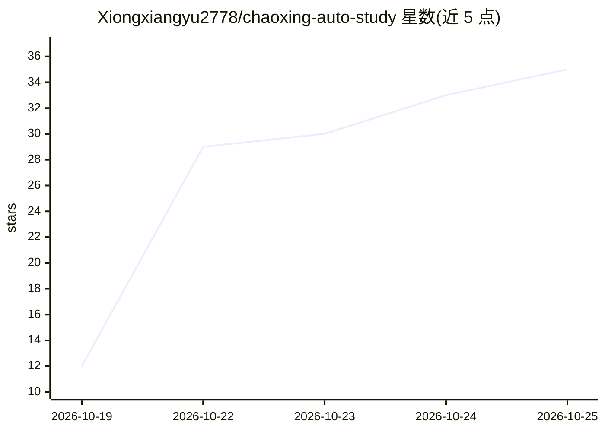

# Xiongxiangyu2778/chaoxing-auto-study

⭐ 36 · JavaScript · 推送 2026-10-25 · [GitHub](https://github.com/Xiongxiangyu2778/chaoxing-auto-study) · 个人维护 · 中文 README

**超星学习通自动化工具：挂机刷章节+作业/考试AI代写代答**

基于 Playwright（CDP 连接独立 Edge）的超星学习通三模块自动化工具箱：章节视频/测验挂机（按视频时长自动匹配倍速、本地题库与弹题自动作答）；作业题目导出→OpenAI 兼容模型代写→自动填答→归档纯文本；考试逐题导出→AI 作答（含听力转写）→逐题填答。默认走智谱 glm-5.3-flash 并自动降级免费模型。面向 Windows 用户，双击 bat 一键安装运行；验证码/诚信承诺/最终提交环节需人工完成。

## 筛选速览

| 维度 | 判定 | 备注 |
|---|---|---|
| AI 角色 | `ai-native` | 本体是模型或模型工具 |
| 许可风险 | `none` | — |
| 部署形态 | `None` |  |
| 模型依赖 | — | README 未给出锁定关系 |
| 硬件要求 | — | 无带数字的原话,不猜 |
| 安装摩擦 | `low` | 无编译、无系统依赖或容器化 |
| 成熟度 | — | 结构信号不足 |

## 能力要点

- 三模块一键启动：刷章节/作业AI代写/考试AI代答
- 按视频时长自动匹配倍速，配置热重载
- 任意 OpenAI 兼容接口（智谱/DeepSeek/通义/Kimi），默认智谱免费兜底
- 作业与考试产物归档为纯文本（题目+答案+考点）

## 适用场景

- 挂机自动刷完章节视频与测验
- 让 AI 代写作业并自动填答归档
- 考试逐题 AI 作答，含听力转写辅助

## 场景标签

`浏览器自动化` `工作流自动化` · 领域:效率与自动化

## 证据(README 行号)

> L7: > 一套基于 Playwright（CDP 连接独立 Edge）的超星学习通自动化工具箱：
> L8: > **挂机刷章节视频/测验** + **作业题目导出 → AI 代写 → 自动填答 → 归档** +
> L62: 1. 双击 `一键-配置AI.bat` → 粘贴 API key（智谱 / DeepSeek / 通义 / Kimi 等 OpenAI 兼容接口，只需一次）

## 星数曲线

2026-10-19 12 → 2026-10-25 35（+23）

---
*卡片 v1 · prompt 1.4 · 生成 2026-10-25 · 置信度 high · 依据 README sha `f713cf5d6d51` · [字段定义](../../DATASET.md)*
