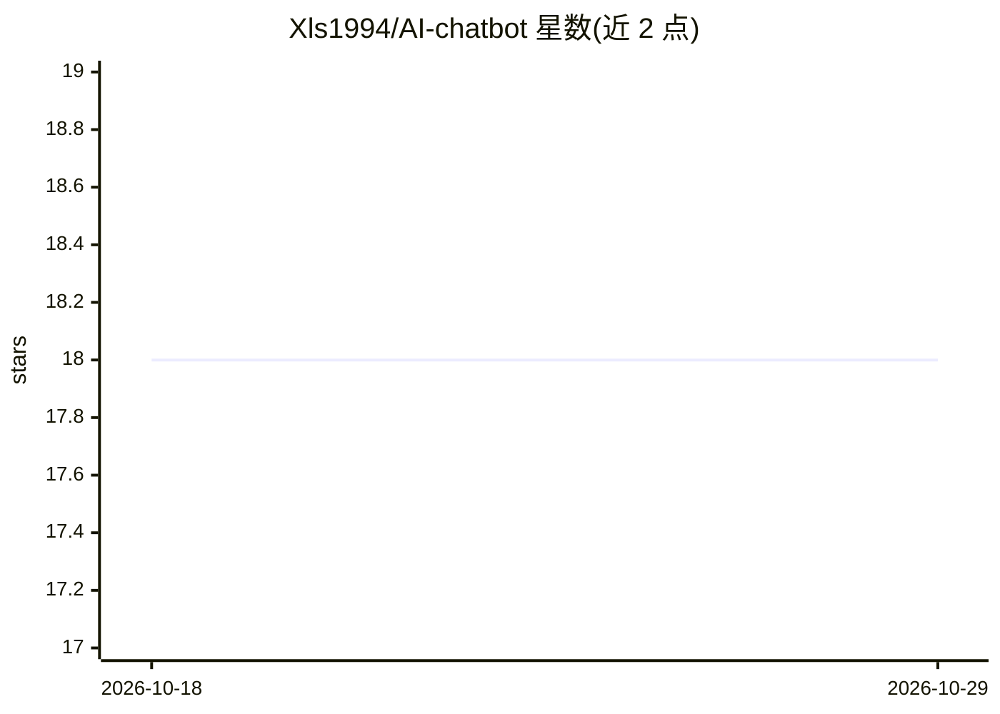

# Xls1994/AI-chatbot

⭐ 18 · Python · Apache-2.0 · 推送 2025-12-21 · [GitHub](https://github.com/Xls1994/AI-chatbot) · 个人维护 · 中文 README

**本地个人助理聊天机器人：langchain+gradio 搭建**

基于 langchain 与 gradio 搭建的本地个人助理聊天机器人，采用 RAG 检索增强生成，向量存储使用 chromadb，嵌入使用 FlagEmbedding，Web 界面由 gradio 提供。运行需 Python 3.8 以上环境，通过 pip 安装 flask、chromadb、gradio、fastapi、langchain、FlagEmbedding 等依赖。智谱 API 相关代码链接至作者另一仓库 llm-universe，详细教程发布在知乎专栏。

## 筛选速览

| 维度 | 判定 | 备注 |
|---|---|---|
| AI 角色 | `ai-native` | 本体是模型或模型工具 |
| 许可风险 | `permissive` | Apache-2.0 |
| 部署形态 | `library` | 以包/库形式分发 |
| 模型依赖 | — | README 未给出锁定关系 |
| 硬件要求 | — | 无带数字的原话,不猜 |
| 安装摩擦 | `low` | 无编译、无系统依赖或容器化 |
| 成熟度 | — | 结构信号不足 |

## 能力要点

- langchain+gradio 构建本地对话助理
- RAG 检索：chromadb 向量库 + FlagEmbedding 嵌入
- 智谱 API 适配代码另存于 llm-universe 仓库

## 适用场景

- 搭建本地 RAG 问答个人助理
- 学习 langchain+gradio 的聊天机器人实现
- 接入智谱 API 做中文对话应用

## 场景标签

`聊天机器人` `RAG` · 领域:对话与助手

## 证据(README 行号)

> L2: 基于 langchain+gradio 搭建本地个人助理。
> L9: ```pip install flask chromadb gradio fastapi langchain FlagEmbedding ```

## 星数曲线



2026-10-18 18 → 2026-10-29 18（+0）


---
*卡片 v1 · prompt 1.4 · 生成 2026-10-29 · 置信度 high · 依据 README sha `8700d3a1df26` · [字段定义](../../DATASET.md)*
