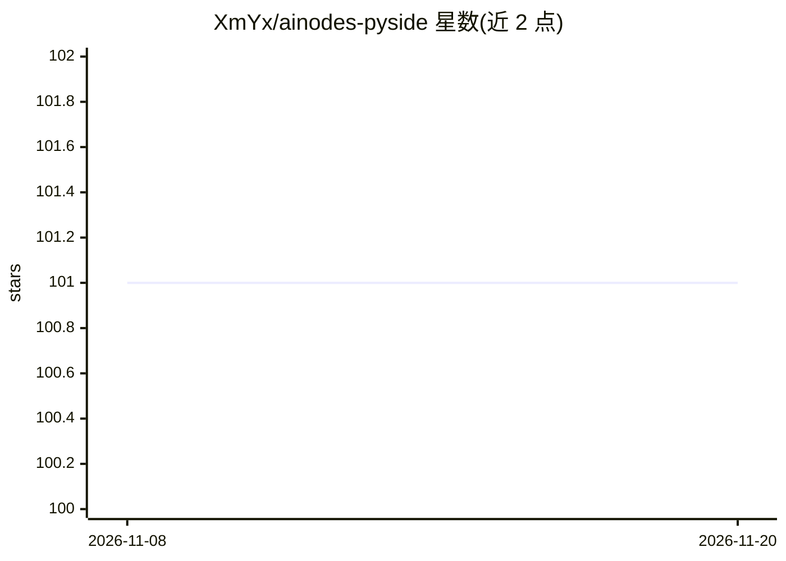

# XmYx/ainodes-pyside

⭐ 101 · Python · LGPL-2.1 · 推送 2026-11-07 · [GitHub](https://github.com/XmYx/ainodes-pyside) · 个人维护

**桌面端 AI 图像生成应用：本地运行 Stable Diffusion/FLUX 生成图像**

基于 PySide6 的桌面 AI 图像应用，提供文生图、无限画布上的局部重绘与外绘、Deforum 动画、放大与图像实验室等功能。可在本地 GPU 上运行 Stable Diffusion 1.x/2.x 及 FLUX.2/FLUX.3/Krea 2 等模型（经 diffusers），或将任务交给 ComfyUI 服务器。启动器按 GPU 类型（NVIDIA CUDA、AMD ROCm、Intel XPU、Apple MPS、CPU）自动选择 PyTorch 构建，加载前实测空闲显存并选择全量/fp8/交换/流式加载策略。通过 start.sh/start.bat 一步安装，首次启动下载若干 GB 支持模型。

## 筛选速览

| 维度 | 判定 | 备注 |
|---|---|---|
| AI 角色 | `ai-native` | 本体是模型或模型工具 |
| 许可风险 | `viral` | LGPL-2.1 |
| 部署形态 | `None` |  |
| 模型依赖 | — | README 未给出锁定关系 |
| 硬件要求 | `cpu-ok` | |
| 安装摩擦 | `medium` | 含编译或系统依赖之一 |
| 成熟度 | — | 结构信号不足 |

## 能力要点

- 本地经 diffusers 运行 FLUX.2/FLUX.3/Krea 2，或交由 ComfyUI 后端生成
- 加载前实测空闲 VRAM，自动选择全量/fp8/交换/流式加载
- 画布局部重绘与外绘支持单块与批量，多后端无缝融合
- 启动器按 NVIDIA/AMD/Intel/Apple/CPU 自动匹配 PyTorch 构建

## 适用场景

- 在本地 GPU 上文生图并做局部重绘/外绘
- 用 ComfyUI 服务器作为后端生成 SDXL 及更新的模型
- 批量出图、XY 网格对比、放大与图像批量处理

## 场景标签

`图像生成` · 领域:内容生成

## 证据(README 行号)

> L12: aiNodes is a desktop app for AI image making: text to image, an infinite canvas for inpainting and
> L13: outpainting, Deforum animation, upscalers and an image lab. It runs Stable Diffusion 1.x / 2.x and current
> L14: models such as **FLUX.2**, **FLUX.3** and **Krea 2** on your own GPU, or hands the work to a

## 星数曲线

2026-11-08 101 → 2026-11-20 101（+0）

---
*卡片 v1 · prompt 1.4 · 生成 2026-11-17 · 置信度 high · 依据 README sha `0361621600ae` · [字段定义](../../DATASET.md)*
