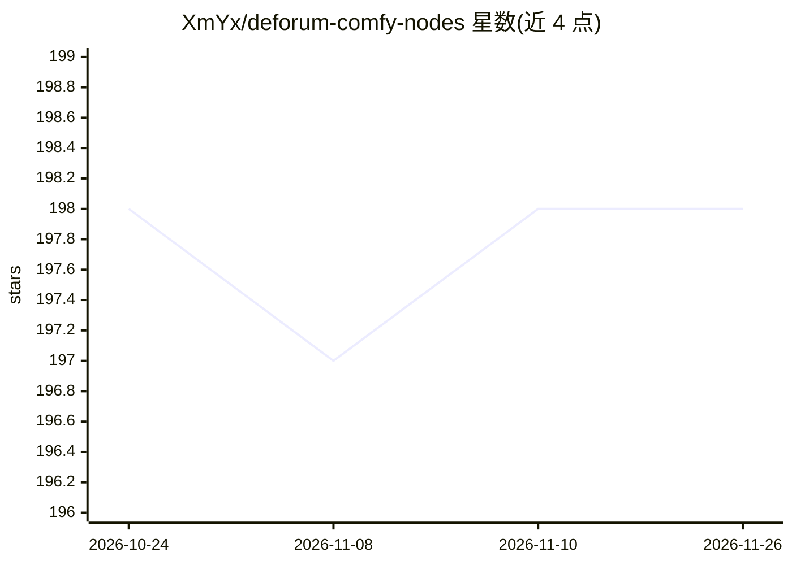

# XmYx/deforum-comfy-nodes

⭐ 198 · Python · MIT · 推送 2026-11-23 · [GitHub](https://github.com/XmYx/deforum-comfy-nodes) · [官网](https://deforum.studio/) · 个人维护

**给 ComfyUI 用户的 Deforum 帧驱动 AI 动画节点包**

为 ComfyUI 提供的 Deforum 动画节点集合，在普通 ComfyUI 图内逐帧驱动 2D/3D 相机运动、cadence、混合视频、调度表与提示词插值，并输出 mp4。经 ComfyUI 0.44.2 与 deforum-studio 0.2.0 验证，依赖从 requirements.txt 安装（需 Git 或 zip 途径），Save Video 节点需 PATH 上的 ffmpeg。支持 SD 1.5 至 FLUX.3、Qwen-Image、Krea-2 等潜在空间族，附多个示例工作流、引导图调度与故障排查章节。

## 筛选速览

| 维度 | 判定 | 备注 |
|---|---|---|
| AI 角色 | `ai-native` | 本体是模型或模型工具 |
| 许可风险 | `permissive` | MIT |
| 部署形态 | `desktop` | 安装包/桌面程序 |
| 模型依赖 | — | README 未给出锁定关系 |
| 硬件要求 | — | 无带数字的原话,不猜 |
| 安装摩擦 | `medium` | 含编译或系统依赖之一 |
| 成熟度 | — | 结构信号不足 |

## 能力要点

- 在 ComfyUI 图内逐帧驱动 2D/3D 运动与提示词插值
- latent_type=auto 从模型读取潜在形状，支持 SD/FLUX/Qwen-Image/Krea-2 等族
- 引导图调度：按关键帧脉冲牵引并支持交叉淡入
- 大多数参数字段接受 frame:(expression) 形式的 deforum 调度表

## 适用场景

- 在 ComfyUI 里制作逐帧扩散动画并直接输出 mp4
- 按调度表在关键帧间切换与混合提示词
- 用引导图把动画锁定到指定构图

## 场景标签

`图像生成` `视频生成` · 领域:内容生成

## 证据(README 行号)

> L3: Deforum animation nodes for ComfyUI — 2D/3D camera motion, cadence, hybrid video,
> L4: schedules and prompt interpolation, driven frame by frame from inside a normal

## 星数曲线

2026-10-24 198 → 2026-11-26 198（+0）

---
*卡片 v1 · prompt 1.4 · 生成 2026-11-25 · 置信度 high · 依据 README sha `5a7d0394398b` · [字段定义](../../DATASET.md)*
