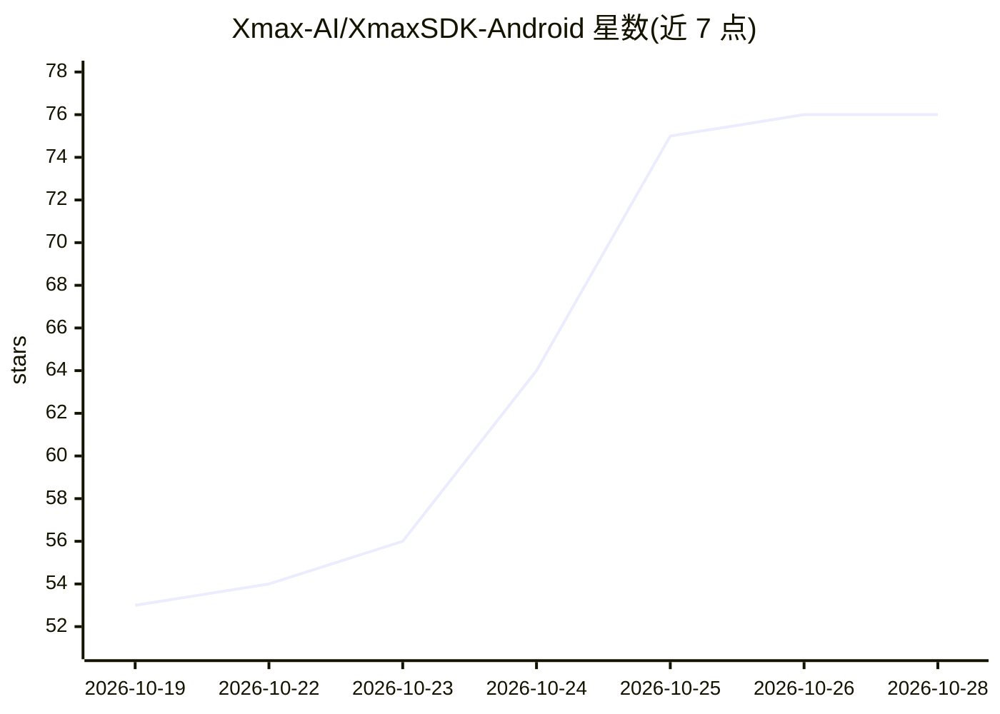

# Xmax-AI/XmaxSDK-Android

⭐ 76 · Kotlin · MIT · 推送 2026-10-27 · [GitHub](https://github.com/Xmax-AI/XmaxSDK-Android) · [官网](https://platform.xmax.ai/docs) · 组织维护 · 中文 README

**面向 Android 开发者的 Xmax 实时交互式视频生成 SDK**

原生 Android SDK（Kotlin），封装接入 Xmax 模型的实时交互式视频生成全流程：媒体采集、视频流传输、逐帧生成与端上渲染，需 Xmax API key，经 Maven Central 分发（版本 1.0.11，依赖 Agora RTC 传输）。支持摄像头/图片/本地视频/网络视频作为输入，提供实时角色替换、虚拟试穿、视频风格化、AI 陪伴角色、Live Photo 等用例，默认连接中国服务环境，可选全球环境。提供 Jetpack Compose 组件与事件监听接口。

## 筛选速览

| 维度 | 判定 | 备注 |
|---|---|---|
| AI 角色 | `ai-ecosystem` | LLM/agent 周边工具 |
| 许可风险 | `permissive` | MIT |
| 部署形态 | `None` |  |
| 模型依赖 | — | README 未给出锁定关系 |
| 硬件要求 | — | 无带数字的原话,不猜 |
| 安装摩擦 | `medium` | 含编译或系统依赖之一 |
| 成熟度 | — | 结构信号不足 |

## 能力要点

- 端到端流水线：媒体采集、RTC 视频流、逐帧生成、端上渲染
- 支持摄像头/图片/本地视频/URL 视频多种输入与触摸轨迹交互
- 提供 XmaxRealtimeVideo 等 Jetpack Compose 组件与 View 封装
- 默认中国服务环境，可切换全球环境（api.xmax.cloud）

## 适用场景

- 在 Android 应用中实现实时角色替换或虚拟试穿
- 将参考图驱动的视频风格化能力集成进创意应用
- 通过触摸轨迹让图片中的角色动起来（Live Photo）

## 场景标签

`视频生成` · 领域:内容生成

## 证据(README 行号)

> L8: We introduce XmaxSDK, a native Android SDK designed for real-time interactive video generation via Xmax models. Xmax
> L108: - An Xmax API key
> L117: XmaxSDK is distributed through **Maven Central**.

## 星数曲线

2026-10-19 53 → 2026-10-28 76（+23）

---
*卡片 v1 · prompt 1.4 · 生成 2026-10-24 · 置信度 high · 依据 README sha `d7822f893306` · [字段定义](../../DATASET.md)*
