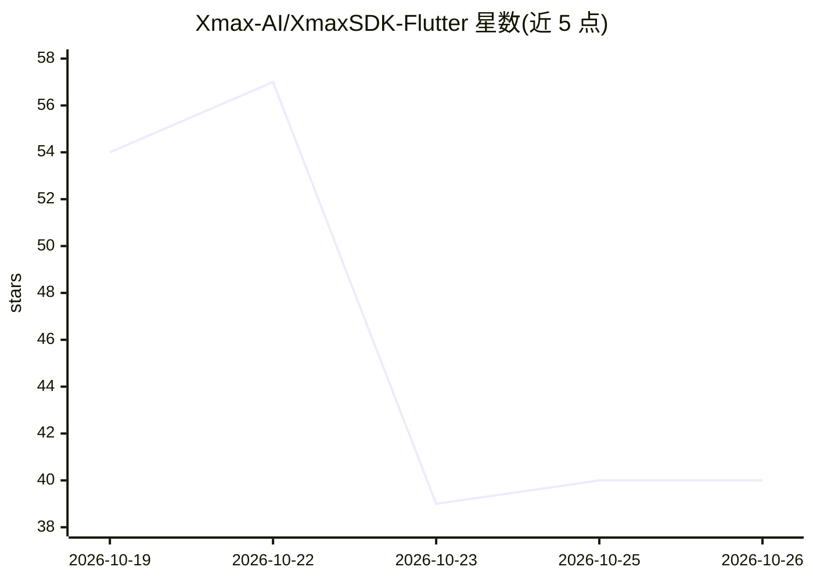

# Xmax-AI/XmaxSDK-Flutter

⭐ 40 · Dart · MIT · 推送 2026-10-25 · [GitHub](https://github.com/Xmax-AI/XmaxSDK-Flutter) · [官网](https://www.xmaxai.com) · 组织维护 · 中文 README

**接入 Xmax 实时交互式视频生成云服务的 Flutter SDK**

Xmax 官方提供的 Flutter SDK，供开发者将 Xmax 云端实时视频生成模型集成到 iOS/Android 应用。SDK 封装端到端流程：采集摄像头画面、经低延迟通道推流至云端推理服务、对返回视频做设备端增强并渲染，支持角色替换、虚拟试穿、视频风格化、AI 伴侣等场景。通过 Dart API 与 Flutter 组件暴露生成控制、前后摄切换、状态/网络质量/性能监听与资源清理；需 Xmax API key，默认中国环境可切换全球环境，Android 构建需 Java 17。

## 筛选速览

| 维度 | 判定 | 备注 |
|---|---|---|
| AI 角色 | `ai-ecosystem` | LLM/agent 周边工具 |
| 许可风险 | `permissive` | MIT |
| 部署形态 | `None` |  |
| 模型依赖 | — | README 未给出锁定关系 |
| 硬件要求 | — | 无带数字的原话,不猜 |
| 安装摩擦 | `medium` | 含编译或系统依赖之一 |
| 成熟度 | — | 结构信号不足 |

## 能力要点

- 封装采集→推流→云端生成→端上渲染的端到端流程
- 支持角色替换、虚拟试穿、风格化、AI 伴侣四类实时场景
- 提供状态机、网络质量与性能告警监听器
- china/global 双环境切换，MIT 许可

## 适用场景

- 在移动应用中接入实时角色替换或虚拟试穿
- 构建与虚拟角色手势互动的摄像头应用
- 为现有 Flutter 应用添加实时视频风格化功能

## 场景标签

`视频生成` · 领域:内容生成

## 证据(README 行号)

> L10: A Flutter SDK, providing access to Xmax's real-time, interactive video generation
> L24: XmaxSDK offers a complete workflow that covers media acquisition, low-latency video
> L26: live camera feeds, it streams media to our cloud inference service, applies

## 星数曲线

2026-10-19 54 → 2026-10-26 40（-14）

---
*卡片 v1 · prompt 1.4 · 生成 2026-10-25 · 置信度 high · 依据 README sha `6d099749fc12` · [字段定义](../../DATASET.md)*
