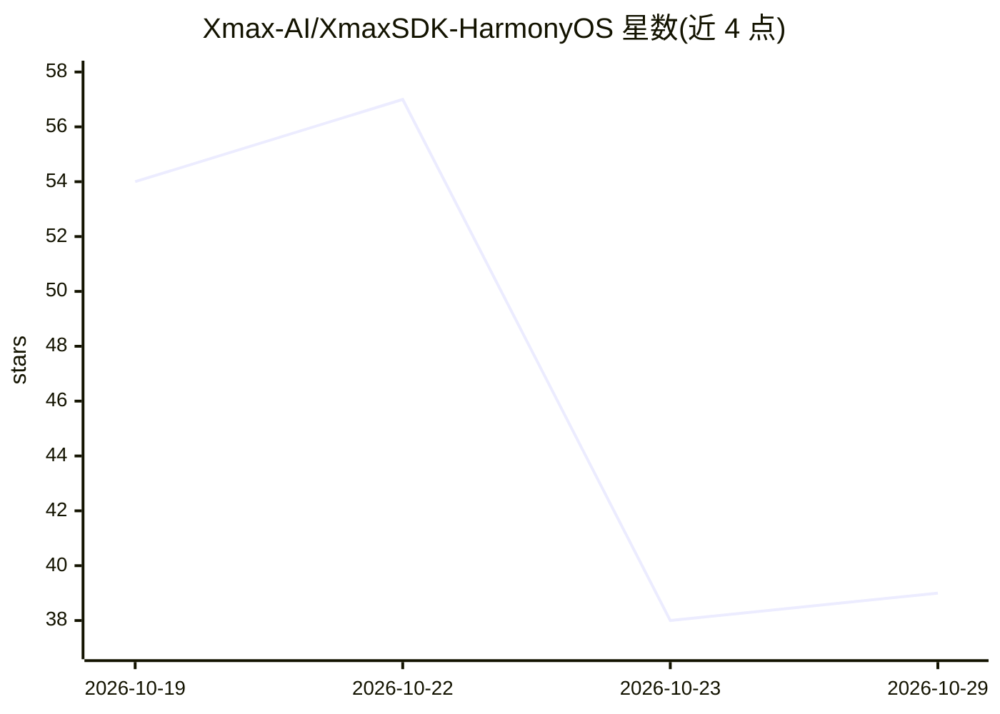

# Xmax-AI/XmaxSDK-HarmonyOS

⭐ 39 · TypeScript · MIT · 推送 2026-10-27 · [GitHub](https://github.com/Xmax-AI/XmaxSDK-HarmonyOS) · [官网](https://platform.xmax.ai/docs) · 组织维护 · 中文 README

**面向 HarmonyOS 开发者的实时交互式视频生成 SDK**

XmaxSDK 是以 ArkTS 编写的鸿蒙原生 SDK，封装 Xmax 模型的实时交互式视频生成能力：端到端管线覆盖媒体采集、视频流传输、逐帧生成与端上渲染，供开发者在应用中集成低延迟视频变换。支持角色替换、虚拟试穿、视频风格化、AI 伙伴、Live Photo 等场景。要求 HarmonyOS 5.1.0（API 18）以上与 Xmax API key；以 HAR 包配合 ohpm 手动集成，依赖 VolcEngine RTC SDK 与腾讯云 COS SDK。

## 筛选速览

| 维度 | 判定 | 备注 |
|---|---|---|
| AI 角色 | `ai-ecosystem` | LLM/agent 周边工具 |
| 许可风险 | `permissive` | MIT |
| 部署形态 | `None` |  |
| 模型依赖 | — | README 未给出锁定关系 |
| 硬件要求 | — | 无带数字的原话,不猜 |
| 安装摩擦 | `low` | 无编译、无系统依赖或容器化 |
| 成熟度 | — | 结构信号不足 |

## 能力要点

- 端到端管线：媒体采集、视频流、逐帧生成、端上渲染
- 实时角色替换、虚拟试穿、风格化、AI 伙伴、Live Photo 等用例
- 相机/麦克风权限检查、播放控制、状态/网络质量/性能告警监听器
- 提供 ArkUI 示例工程（examples/XLab）

## 适用场景

- 在鸿蒙应用中接入实时角色替换或虚拟试穿
- 为直播/相机流叠加 AI 生成内容与虚拟角色互动
- 通过轨迹绘制让图片动起来（Live Photo）

## 场景标签

`视频生成` · 领域:内容生成

## 证据(README 行号)

> L8: We introduce XmaxSDK, a native HarmonyOS SDK designed for real-time interactive video generation via Xmax models. Xm
> L115: The current release is distributed as a Harmony Archive (HAR). XmaxSDK depends on

## 星数曲线

2026-10-19 54 → 2026-10-29 39（-15）

---
*卡片 v1 · prompt 1.4 · 生成 2026-10-25 · 置信度 high · 依据 README sha `36b221c2b1df` · [字段定义](../../DATASET.md)*
