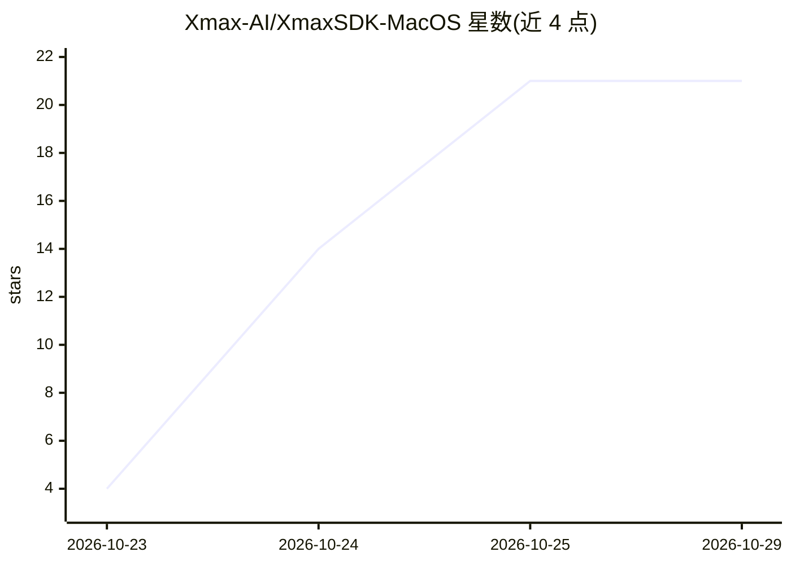

# Xmax-AI/XmaxSDK-MacOS

⭐ 21 · Swift · MIT · 推送 2026-10-27 · [GitHub](https://github.com/Xmax-AI/XmaxSDK-MacOS) · [官网](https://platform.xmax.ai/docs) · 组织维护 · 中文 README

**macOS SDK：接入 Xmax 模型做实时交互式视频生成**

面向 macOS 开发者的 Swift SDK，封装 Xmax 模型的实时交互式视频生成管线：覆盖媒体采集、视频流传输、逐帧生成与端上渲染，示例用途包括角色替换、虚拟试穿、视频风格化与 AI 虚拟角色互动。依赖 Agora RTC SDK 做低延迟音视频通信、腾讯云 COS SDK 做对象存储上传下载；使用需 Xmax API key，要求 macOS 13.0+、Swift 6 与 Xcode 26+。提供 Swift Package Manager、CocoaPods 与手动集成三种安装方式。

## 筛选速览

| 维度 | 判定 | 备注 |
|---|---|---|
| AI 角色 | `ai-ecosystem` | LLM/agent 周边工具 |
| 许可风险 | `permissive` | MIT |
| 部署形态 | `None` |  |
| 模型依赖 | — | README 未给出锁定关系 |
| 硬件要求 | — | 无带数字的原话,不猜 |
| 安装摩擦 | `low` | 无编译、无系统依赖或容器化 |
| 成熟度 | — | 结构信号不足 |

## 能力要点

- 端到端管线：媒体采集、视频流、逐帧生成与设备端渲染
- 支持角色替换、虚拟试穿、风格化、AI 虚拟角色四类实时用例
- Swift Package Manager / CocoaPods / 手动集成三种安装途径
- 依赖 Agora RTC 与腾讯云 COS 完成实时通信与媒体存取

## 适用场景

- 在 macOS 应用中实现摄像头画面的实时角色替换
- 为创意应用接入低延迟实时视频风格化与虚拟试穿
- 把虚拟角色叠加进实时视频流并与手势交互

## 场景标签

`视频生成` · 领域:内容生成

## 证据(README 行号)

> L8: We introduce XmaxSDK, a macOS SDK designed for real-time interactive video generation via Xmax models. XmaxSDK imple
> L93: - An Xmax API key
> L102: XmaxSDK supports **Swift Package Manager**,

## 星数曲线

2026-10-23 4 → 2026-10-29 21（+17）

---
*卡片 v1 · prompt 1.4 · 生成 2026-10-28 · 置信度 high · 依据 README sha `7315643db7ad` · [字段定义](../../DATASET.md)*
