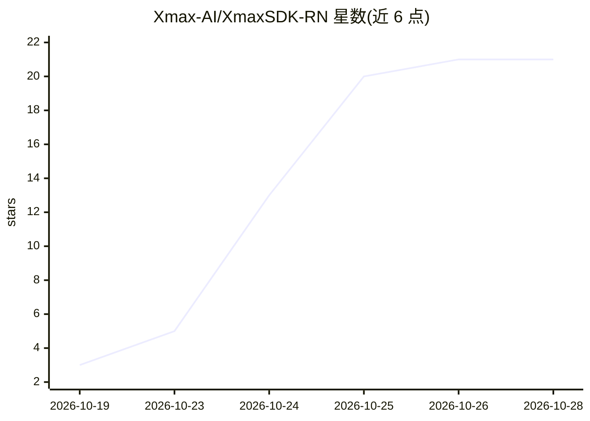

# Xmax-AI/XmaxSDK-RN

⭐ 21 · TypeScript · MIT · 推送 2026-10-27 · [GitHub](https://github.com/Xmax-AI/XmaxSDK-RN) · [官网](https://platform.xmax.ai/docs) · 组织维护 · 中文 README

**React Native SDK：接入 Xmax 模型做实时交互式视频生成**

面向移动端开发者的 React Native SDK，封装 Xmax 模型的实时交互式视频生成端到端管线：媒体采集、视频流传输、逐帧生成与端上渲染。支持 iOS 15.1+/Android API 26+，需 React Native 0.87.1 新架构与 Xmax API key，依赖 Agora RTC SDK 做低延迟音视频通信、腾讯云 COS SDK 做媒体对象存储。README 列出角色替换、虚拟试穿、视频风格化、AI 陪伴角色、Live Photo 五类用例，端到端延迟为百毫秒级，实时生成最高 1080p。

## 筛选速览

| 维度 | 判定 | 备注 |
|---|---|---|
| AI 角色 | `ai-ecosystem` | LLM/agent 周边工具 |
| 许可风险 | `permissive` | MIT |
| 部署形态 | `library` | 以包/库形式分发 |
| 模型依赖 | — | README 未给出锁定关系 |
| 硬件要求 | — | 无带数字的原话,不猜 |
| 安装摩擦 | `low` | 无编译、无系统依赖或容器化 |
| 成熟度 | — | 结构信号不足 |

## 能力要点

- 端到端管线：媒体采集、流传输、逐帧生成与端上渲染
- 官方声称单卡 RTX 5090 运行、端到端延迟百毫秒级
- 内置角色替换/虚拟试穿/视频风格化等五类实时用例
- 依赖 Agora RTC（低延迟通信）与腾讯云 COS（媒体存储）

## 适用场景

- 在 App 中实现摄像头实时角色替换或虚拟试穿
- 为直播或社交应用添加实时视频风格化效果
- 通过绘制运动轨迹让静态图片中的角色动起来

## 场景标签

`视频生成` · 领域:内容生成

## 证据(README 行号)

> L8: We introduce XmaxSDK, a React Native SDK designed for real-time interactive video generation via Xmax models. XmaxSD
> L118: npm install @xmaxai/react-native-sdk@1.1.1 \
> L144: - <ins> Agora RTC SDK </ins> enables low-latency, real-time audio and video communication.

## 星数曲线

2026-10-19 3 → 2026-10-28 21（+18）

---
*卡片 v1 · prompt 1.4 · 生成 2026-10-28 · 置信度 high · 依据 README sha `131c43d08df2` · [字段定义](../../DATASET.md)*
